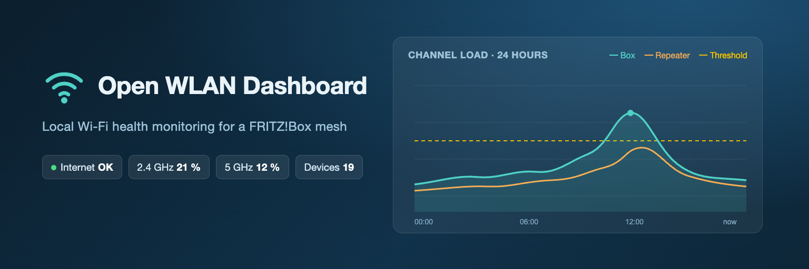

# WLAN Dashboard

Local, read-only health dashboard for a FRITZ!Box mesh (FRITZ!Box + FRITZ!Repeater).
It shows the internet line, channel load and traffic per band, link quality per device
and recent WLAN events, and raises alerts early:

- always-on devices going offline
- reconnect loops (roaming between box and repeater is not counted)
- weak signal of always-on devices
- crowded or noisy channels
- weak repeater uplink
- DSL / internet interruptions, radar interruptions on 5 GHz
- FRITZ!Box restarts in the last 24 h (flagged as a likely crash when the box sent an error report)
- stopped history collection, available FRITZ!OS updates

Clicking a device opens its detail page: connection, signal and noise margin, negotiated and
maximum rates, Wi-Fi standard, streams, latency, addresses, 24 h signal and rate history and
all WLAN events of the device.

WLAN Dashboard includes 44 themes ranging from sci-fi and retro computers to art, places, and
seasons. LCARS is the default selection, and your choice is remembered per browser. Browse the
[THEMES.md](THEMES.md) gallery or see [Themes](#themes) for editing instructions.

Alerts can be acknowledged or muted for 1 h / 24 h; they re-arm automatically when the
problem gets worse, when a mute expires, or when a resolved problem comes back.

Everything runs on your own machine. The dashboard only binds to `127.0.0.1` and only
reads from the FRITZ!Box.

## Files

| File | Purpose |
|---|---|
| `dashboard.py` | The dashboard: web server on http://127.0.0.1:8765, alert logic, data endpoints |
| `web/index.html` | Page markup |
| `web/base.css` | Base design (= the LCARS theme): layout, shapes, colour variables, phone layout |
| `web/app.js` | Page logic: rendering, charts, detail page, acknowledge/mute, theme menu |
| `themes/*.css` | One file per theme; the theme menu is built from this folder |
| `collect.py` | Collector for the 24 h history: WLAN log, link quality per device, channel load. Run every 15 min |
| `live.py` | FRITZ!Box access helpers used by the dashboard (also a minimal standalone traffic view) |
| `launchd/local.wlan-test.collect.plist` | macOS LaunchAgent template that runs `collect.py` every 15 min |

## Setup

1. Create a FRITZ!Box user for the dashboard (System → FRITZ!Box-Benutzer) with
   permission for FRITZ!Box settings. Read access is all the scripts use.
2. Store its password in `~/.claude_fritz` (first line only) and restrict access:

   ```sh
   printf '%s\n' 'the-password' > ~/.claude_fritz && chmod 600 ~/.claude_fritz
   ```

   The user name `claude` and the box address `192.168.178.1` are set at the top of
   `live.py` and `collect.py`.
3. Start the history collector every 15 minutes (macOS):

   ```sh
   sed "s#/path/to/wlan-dashboard#$PWD#g" launchd/local.wlan-test.collect.plist > ~/Library/LaunchAgents/local.wlan-test.collect.plist
   launchctl bootstrap gui/$(id -u) ~/Library/LaunchAgents/local.wlan-test.collect.plist
   ```

   On first run macOS asks for "Local Network" access for `python3`; allow it
   (System Settings → Privacy & Security → Local Network).
4. Start the dashboard and open http://127.0.0.1:8765:

   ```sh
   python3 dashboard.py
   ```

Self-test of the alert logic: `python3 dashboard.py --selftest`

## Themes

A theme is one CSS file in `themes/`. The server reads the folder on every page load, so a new
or edited theme shows up with a browser reload, no restart needed.

```
themes/
  lcars.css        registers LCARS, the base design in web/base.css
  amiga.css        /* theme: Amiga 500 */  html[data-theme="amiga"]{ ... }
  ...
```

### Create a theme

1. Copy a theme that is close to what you want, e.g. `cp themes/macbook.css themes/sunset.css`.
   The file name is the theme id: lowercase letters, digits and `-` only.
2. Line 1 names it in the menu: `/* theme: Sunset */`. Add `; startrek` to show the Star Trek
   alarm words ("Gelber Alarm", "Alle Systeme nominal") and the stardate in the header; other
   themes hide the header badge and show the normal date.
3. Put every rule inside `html[data-theme="sunset"]{ ... }`, with the id from the file name.
   Rules for elements use CSS nesting with `&`, e.g. `& .kpi{border-radius:0}`.
4. Reload the dashboard and pick it from the menu. The menu is sorted by name; LCARS stays first.
5. Add the theme to THEMES.md with a heading in the matching group, one or two sentences of
   description, a link to the CSS file, and a screenshot saved as `assets/themes/sunset.jpg`. Use demo
   data for the screenshot; never include real device names.

A theme file may also hold top-level `@keyframes` and `@media` rules (see `radar.css`,
`bahnhof.css`). Prefix keyframe names with the theme id, since all theme files end up in one
stylesheet, and switch animations off under `prefers-reduced-motion`.

Run `python3 dashboard.py --selftest` afterwards: it checks that every theme file has a name.

### Colour variables

Most of a theme is setting these variables; the base design uses them everywhere.

| Variable | Used for |
|---|---|
| `--bg`, `--panel` | page background; cards, alert rows, table rows |
| `--tx`, `--tx2`, `--mut` | main text; secondary text; hints, axis labels |
| `--o1` `--o2` `--pe` `--li` `--pw` `--sk` `--tan` | accent colours: side bar buttons, section headings, card titles, buttons |
| `--on` | text on a filled accent or status colour |
| `--good`, `--warn`, `--crit`, `--info` | status colours: OK (green), warning (**yellow**), critical (**red**), info |
| `--on-warn` | text on the yellow warning colour (keep it dark) |
| `--thr` | warning threshold line in the charts (optional, defaults to `--warn`); set a darker tone on light backgrounds |
| `--s1`, `--s2` | the two chart lines (download/upload, box/repeater) |
| `--grid`, `--axis` | chart grid and axis lines |
| `--font`, `--head` | body font; font for headings, numbers and the side bar |
| `--big` | font size of the big numbers in summary cards (default 40px); themes set this instead of styling `.big` directly |
| `--big-fit` | max width share of a card for big numbers in `cqi` units (default 22cqi); use lower values (11–21cqi) for wide fonts to prevent clipping |

Fonts come from Google Fonts; add a new family to the font link in `web/index.html`.

### Shapes

Beyond colours, a theme can restyle any part of the page. The main classes:

| Class | Part of the page |
|---|---|
| `.rail`, `.elbow`, `.pill`, `.fill` | side bar: corner pieces, buttons, filler |
| `.main > .bar` | coloured bars above and below the content |
| `.alarm` | header badge (only visible in `startrek` themes) |
| `.hb` with `::before` / `::after` | section headings and their decorations |
| `.kpi`, `.big`, `.sm` | summary cards, big numbers, small text |
| `.alert`, `.alert .tag`, `.btn` | alert rows, their colour field, buttons |
| `.chart`, `.ln`, `.th`, `.tip` | charts, lines, threshold line, tooltip |
| `table`, `th`, `td`, `.st` | device list, status word |
| `.log`, `.info` | event log, detail page data list |

Set `display` on `.rail` only to hide it (`none`); the phone layout hides it below 900 px width,
and any other value would show it there again.

### Rules of thumb

- Warning stays yellow and critical stays red in every theme; the colour field in front of an
  alert carries no text.
- Text needs a contrast of at least 4.5:1 against its background, the threshold line 3:1.
  Light themes need darker accent colours for text (card titles, table headers) than for fills.
- Check the overview, a device detail page (click a device) and a phone-width window.

## Tuning

Alert thresholds are constants at the top of `dashboard.py` (channel load, noise, signal,
reconnects per hour, repeater uplink, DSL noise margin, "always-on" detection).

Devices that should never count as always-on (e.g. a game console or a tablet that is often
switched off) go into `config.local.json` next to `dashboard.py`; they then raise no offline
or weak-signal alerts. The file is git-ignored because it contains MAC addresses:

```json
{ "never_always_on": ["AA:BB:CC:DD:EE:FF"] }
```

## Private data — never commit

The collector and the dashboard write MAC addresses, device names and network events into
this directory (`*.csv`, `*.jsonl`, `*.log`, `acks.json`, `config.local.json`). They are excluded via
`.gitignore`, as is the password file. Python standard library only, no dependencies.
