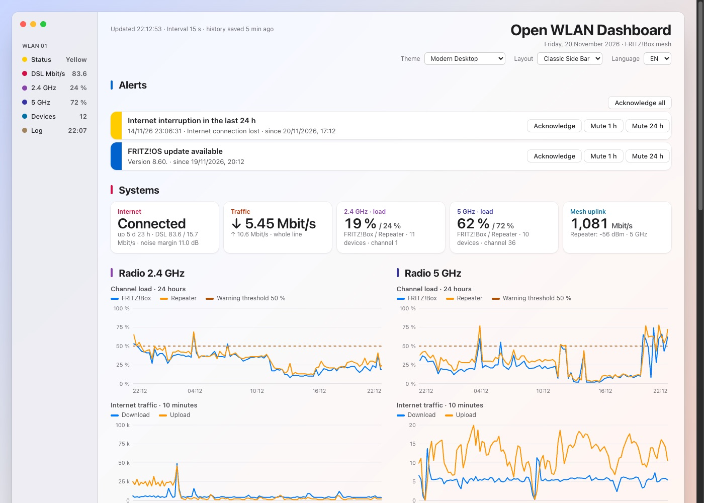
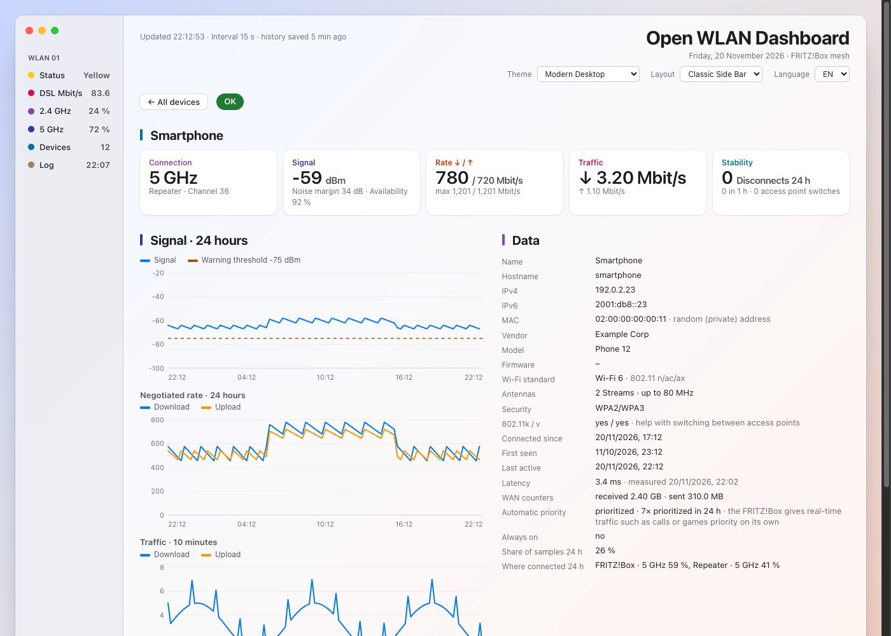

# Open WLAN Dashboard

A local, read-only health dashboard for a FRITZ!Box mesh: the FRITZ!Box and any number of
FRITZ!Repeaters or other mesh routers. It shows the internet line, channel load and traffic per band,
the link quality of every WLAN device and recent WLAN events, and raises alerts before problems
become annoying. Everything runs on your own computer; the dashboard only reads from the FRITZ!Box.



## Features

**Alerts**

- always-on devices going offline
- reconnect loops (roaming between access points is not counted, nor is a device that stays away
  longer than 10 minutes, e.g. in standby)
- weak signal of always-on devices
- crowded or noisy channels
- weak or missing uplink of each mesh router (5 GHz, 2.4 GHz or LAN cable)
- DSL and internet interruptions, radar interruptions on 5 GHz
- FRITZ!Box restarts in the last 24 h (flagged as a likely crash when the box sent an error report)
- stopped history collection, available FRITZ!OS updates

Each alert shows since when it exists. Alerts can be acknowledged or muted for 1 h or 24 h; they come
back when the problem gets worse, when a mute expires, or when a solved problem returns.

**Devices**

The device list has one section per access point, with signal, negotiated rate, traffic,
disconnects and roaming. Devices the FRITZ!Box prioritizes on its own because of real-time traffic
such as calls or games (automatic prioritization, FRITZ!OS 8) are marked, with the count of the last 24 h.


Clicking a device opens its detail page: connection, signal and noise margin, negotiated and
maximum rates, Wi-Fi standard, streams, latency, addresses, 24 h signal and rate history and all
WLAN events of the device.



**Mesh**

Every mesh router gets its own values: channel load, noise, clients and its uplink to the mesh.
The box shows as "FRITZ!Box", the other routers with their name from the box (or a shorter name
from the [settings](#settings)).

**Look**

- 100 [themes](THEMES.md), from sci-fi and retro computers to art, places and seasons. Modern
  Desktop is the default.
- 20 [layouts](#layouts) that change the arrangement: tabs, a floating dock, a phone app, a big
  status banner, a control room with three columns, a bento grid, a magazine page, status rings,
  a wall display and more. Any theme works with any layout.
- English and German.

Theme, layout and language are chosen in the page header and remembered per browser.


The screenshots show demo data, no real devices.

## Requirements

- Python 3.9 or newer, standard library only, no dependencies (the `python3` that ships with macOS is enough),
  or Docker (see [Docker](#docker))
- macOS for the bundled collector schedule; on other systems run `collect.py` every 15 minutes with cron or similar
- FRITZ!Box with any number of mesh routers; tested with a FRITZ!Box 7530 AX and one FRITZ!Repeater 2700 on FRITZ!OS 8.50
- A current browser (the themes use CSS nesting)

## Setup

1. Create a FRITZ!Box user for the dashboard (System → FRITZ!Box-Benutzer) with permission for
   FRITZ!Box settings. The scripts only read.
2. Store its password in a file only you can read (first line only):

   ```sh
   printf '%s\n' 'the-password' > ~/.claude_fritz && chmod 600 ~/.claude_fritz
   ```

3. Create your settings from the template and adjust them, at least the box address and user name
   if they differ from `192.168.178.1` and `claude` (see [Settings](#settings)):

   ```sh
   cp .env.example .env && chmod 600 .env
   ```

4. Start the history collector every 15 minutes (macOS):

   ```sh
   sed "s#/path/to/open-wlan-dashboard#$PWD#g" launchd/local.open-wlan-dashboard.collect.plist > ~/Library/LaunchAgents/local.open-wlan-dashboard.collect.plist
   launchctl bootstrap gui/$(id -u) ~/Library/LaunchAgents/local.open-wlan-dashboard.collect.plist
   ```

   On the first run macOS asks for "Local Network" access for `python3`; allow it
   (System Settings → Privacy & Security → Local Network).
5. Start the dashboard and open http://127.0.0.1:8765:

   ```sh
   python3 dashboard.py
   ```

Self-test: `python3 dashboard.py --selftest`

## Docker

Instead of steps 4 and 5 you can run the dashboard and the collector in containers:

```sh
cp .env.example .env && chmod 600 .env   # then set OWD_FRITZ_PASSWORD and OWD_IP in .env
docker compose up -d
```

Open http://127.0.0.1:8765. `compose.yaml` starts two services from one image: the dashboard and the
collector, which runs every 15 minutes. They share the volume `data` for history and alert states.

- **Password:** set `OWD_FRITZ_PASSWORD` in `.env`, or mount your password file read-only and point
  `OWD_FRITZ_PASSWORD_FILE` to it.
- **`OWD_IP`:** the LAN address of the computer that runs Docker. A container sees its own address, so
  without this setting the box's traffic figures for that computer are not matched.
- **`TZ`:** the time zone of the box log, `Europe/Berlin` unless set in `.env`.
- **Access:** the port is published on `127.0.0.1` of the host only; `OWD_DASHBOARD_PORT` in `.env` changes it.
- **Update:** `docker compose up -d --build`. **Stop:** `docker compose down` (add `-v` to delete the history).

The image contains the code only (see `.dockerignore`), runs as an unprivileged user and runs the
self-test while it is built.

**Update:** pull the new version and restart `dashboard.py`; the collector picks up the new code on
its next run. Your `.env`, history and alert states stay.

**Stop the collector:** `launchctl bootout gui/$(id -u)/local.open-wlan-dashboard.collect`

## Settings

All settings live in `.env` next to `dashboard.py`. Every setting is optional and has the default shown
in [`.env.example`](.env.example), which also explains each one; an environment variable of the same
name wins over the file. Restart `dashboard.py` after a change; the collector reads `.env` on its next run.

- **FRITZ!Box access:** `OWD_FRITZ_HOST`, `OWD_FRITZ_USER`, and the password either as `OWD_FRITZ_PASSWORD` or
  (default) in the file `OWD_FRITZ_PASSWORD_FILE`.
- **Mesh routers:** `OWD_MESH_NAMES=fritzrepeaterkeller=Cellar,...` gives routers shorter names, by their
  name in the box (as in the box's WLAN log).
- **Dashboard:** `OWD_DASHBOARD_PORT`, `OWD_POLL_S` (refresh interval in seconds), `OWD_DATA_DIR` (where history and
  alert states are written). The dashboard listens on `127.0.0.1` (`OWD_DASHBOARD_BIND`; only the Docker
  image changes it, and compose still publishes the port on this computer only).
- **Docker:** `OWD_IP` and `TZ`, see [Docker](#docker).
- **Alert thresholds:** channel load, noise, signal, disconnects per hour, mesh uplink, DSL noise margin,
  collector and restart times, and the time windows for roaming and reconnects.
- **Always-on detection:** `OWD_ALWAYS_ON_SHARE`, `OWD_ALWAYS_ON_MIN_SAMPLES`, and `OWD_NEVER_ALWAYS_ON`, a
  comma-separated list of MAC addresses that never count as always-on (e.g. a game console that is
  often switched off); they raise no offline or weak-signal alerts.

## How it works

- `dashboard.py` is a small web server (Python standard library only) on `http://127.0.0.1` and the
  port from `OWD_DASHBOARD_PORT`. Nothing outside this computer can reach it.
- It logs in to the FRITZ!Box with its own user and only reads; it never changes settings.
- On every refresh (`OWD_POLL_S`, default 15 s; several open tabs share one query) it reads the mesh
  topology with the link quality of every WLAN device, the online monitor for traffic, the network
  device list, DSL and internet status and the box log.
- The FRITZ!Box is the mesh master and reports the whole mesh, so mesh routers are never queried
  directly. This is why any number of them works.
- The 24 h history (signal, rate and channel load over time, WLAN log events) comes from `collect.py`,
  which runs every 15 minutes and appends to `links.csv`, `aps.csv` and `events.jsonl` in `OWD_DATA_DIR`.
- Alert acknowledgements and the time each alert first appeared are kept in `acks.json` and `alerts.json`.
- The page (`web/index.html`, `web/app.js`) fetches `/data` and draws its charts itself, without
  external JavaScript libraries.

## Files

| File | Purpose |
|---|---|
| `dashboard.py` | The dashboard: web server, alert logic, data endpoints, self-test |
| `collect.py` | Collector for the 24 h history: WLAN log, link quality per device, channel load |
| `live.py` | FRITZ!Box access used by the dashboard (also a minimal standalone traffic view: `python3 live.py`) |
| `settings.py`, `.env.example` | Settings, see [Settings](#settings) |
| `web/index.html` | Page markup |
| `web/base.css` | Base design (= the Starship Console theme): shapes, colour variables, the classic arrangement, phone layout |
| `web/app.js` | Page logic: rendering, charts, detail page, acknowledge/mute, theme, layout and language menus |
| `web/i18n.js` | All page texts in English and German, see [Translations](#translations) |
| `themes/*.css` | One file per theme; the theme menu is built from this folder |
| `layouts/*.css` | One file per layout; the layout menu is built from this folder |
| `launchd/local.open-wlan-dashboard.collect.plist` | macOS LaunchAgent template that runs `collect.py` every 15 minutes |
| `Dockerfile`, `compose.yaml`, `.dockerignore` | Container image and the two services, see [Docker](#docker) |

## Troubleshooting and known limitations

- **Too much traffic for this computer:** the traffic figures come from the FRITZ!Box online monitor.
  During large downloads it can report much more traffic for the computer that runs the dashboard
  than actually arrives there (observed up to about three times).
- **Channel load shows "–":** the box sometimes reports 0 % when it has no reading, even under load.
  Such readings are shown as "–" and left out of means and charts.
- **"History collection stopped" alert:** the collector only runs while the computer is awake. Check
  `collect.log` and the "Local Network" permission for `python3`.
- **Login fails:** check `OWD_FRITZ_HOST`, `OWD_FRITZ_USER` and the password in `.env` or the password file,
  and that the FRITZ!Box user may access FRITZ!Box settings.

## Themes

A theme is one CSS file in `themes/`. The server reads the folder on every page load, so a new
or edited theme shows up with a browser reload, no restart needed.

```
themes/
  starship.css     registers Starship Console, the base design in web/base.css
  homecomputer.css /* theme: Home Computer; de: Heimcomputer */  html[data-theme="homecomputer"]{ ... }
  ...
```

### Create a theme

1. Copy a theme that is close to what you want, e.g. `cp themes/desktop.css themes/sunset.css`.
   The file name is the theme id: lowercase letters, digits and `-` only.
2. Line 1 names it in the menu: `/* theme: Sunset; de: Sonnenuntergang */`. The German name is
   optional; without `de:` the English name is used in both languages. Add `; starship` to show
   the starship alarm words ("Yellow Alert", "All systems nominal" / "Gelber Alarm", "Alle
   Systeme nominal") and the stardate in the header; other themes hide the header badge and show
   the normal date. Texts a theme adds in CSS can switch per language with `:lang(de)`, see
   `bahnhof.css`.
3. Put every rule inside `html[data-theme="sunset"]{ ... }`, with the id from the file name.
   Rules for elements use CSS nesting with `&`, e.g. `& .kpi{border-radius:0}`.
4. Reload the dashboard and pick it from the menu. The menu is sorted by name; Starship Console stays first.
5. Add the theme to THEMES.md with a heading in alphabetical order, one or two sentences of
   description, a link to the CSS file, and a screenshot saved as `assets/themes/sunset.jpg`. Use demo
   data for the screenshot; never include real device names.

A theme file may also hold top-level `@keyframes` and `@media` rules (see `radar.css`,
`bahnhof.css`). Prefix keyframe names with the theme id, since all theme files end up in one
stylesheet, and switch animations off under `prefers-reduced-motion`.

Run `python3 dashboard.py --selftest` afterwards: it checks that every theme file has a name.

### Colour variables

Most of a theme is setting these variables; the base design uses them everywhere.

| Variable | Used for |
|---|---|
| `--bg`, `--panel` | page background; cards, alert rows, table rows |
| `--tx`, `--tx2`, `--mut` | main text; secondary text; hints, axis labels |
| `--o1` `--o2` `--pe` `--li` `--pw` `--sk` `--tan` | accent colours: side bar buttons, section headings, card titles, buttons |
| `--on` | text on a filled accent or status colour |
| `--good`, `--warn`, `--crit`, `--info` | status colours: OK (green), warning (**yellow**), critical (**red**), info |
| `--on-warn` | text on the yellow warning colour (keep it dark) |
| `--thr` | warning threshold line in the charts (optional, defaults to `--warn`); set a darker tone on light backgrounds |
| `--s1`, `--s2` | the first two chart lines (download/upload, the first two access points) |
| `--grid`, `--axis` | chart grid and axis lines |
| `--font`, `--head` | body font; font for headings, numbers and the side bar |
| `--big` | font size of the big numbers in summary cards (default 40px); themes set this instead of styling `.big` directly |
| `--big-fit` | max width share of a card for big numbers in `cqi` units (default 22cqi); use lower values (11–21cqi) for wide fonts to prevent clipping |

Fonts come from Google Fonts; add a new family to the font link in `web/index.html`.

### Shapes

Beyond colours, a theme can restyle any part of the page. The main classes:

| Class | Part of the page |
|---|---|
| `.rail`, `.elbow`, `.pill`, `.fill` | side bar: corner pieces, buttons, filler |
| `.main > .bar` | coloured bars above and below the content |
| `.alarm` | header badge (only visible in `starship` themes) |
| `.hb` with `::before` / `::after` | section headings and their decorations |
| `.kpi`, `.big`, `.sm` | summary cards, big numbers, small text |
| `.alert`, `.alert .tag`, `.btn` | alert rows, their colour field, buttons |
| `.chart`, `.ln`, `.th`, `.tip` | charts, lines, threshold line, tooltip |
| `table`, `th`, `td`, `.st`, `tr.grp` | device list, status word, access point section rows |
| `.log`, `.info` | event log, detail page data list |

Set `display` on `.rail` only to hide it (`none`); the phone layout hides it below 900 px width,
and any other value would show it there again. Layouts other than Classic replace the side bar
styling with their own, so side bar shapes of a theme only show in the Classic layout.

### Rules of thumb

- Warning stays yellow and critical stays red in every theme; the colour field in front of an
  alert carries no text.
- Text needs a contrast of at least 4.5:1 against its background, the threshold line 3:1.
  Light themes need darker accent colours for text (card titles, table headers) than for fills.
- Check the overview, a device detail page (click a device) and a phone-width window.

## Layouts

A layout changes the arrangement of the page: where the status values, sections and columns go,
their sizes and their order. Colours, fonts and shapes stay with the theme, so any theme works with
any layout. The 20 layouts live in `layouts/`; the layout menu sits next to the theme menu. The
default is Classic Side Bar (id `classic`), the arrangement of `web/base.css`. Every other layout
replaces the theme's side bar ornaments with its own form for the status values.

The server reads the folder on every page load, so a new or edited layout shows up with a browser
reload.

### Create a layout

1. Copy a layout close to what you want, e.g. `cp layouts/cards.css layouts/split.css`. The file
   name is the layout id: lowercase letters, digits and `-` only.
2. Line 1 names it in the menu: `/* layout: Split; de: Geteilt */`. The German name is optional.
3. Put every rule inside `html[data-layout="split"]:not(#_){ ... }` with CSS nesting, e.g.
   `& .rail{...}`. The `:not(#_)` lifts the rules above theme rules, which use more specific selectors.
4. Change only positions, sizes and order. Use the theme's colour variables (`var(--panel)`,
   `var(--tx)`, `var(--axis)`, and `var(--c)` for the status colour of a status value) instead of
   fixed colours.
5. Many layouts dissolve the page wrappers with `display:contents`, so the header, the status values
   (`.rail`) and the sections become cells of one CSS grid (see `layouts/command.css`). Keep
   `#overview` hidden while its `hidden` attribute is set (the detail page uses it):
   `#overview:not([hidden]){display:contents}`.
6. A layout with a fixed bar must switch off `backdrop-filter`, `transform` and `filter` on `.frame`;
   otherwise the bar sticks to the frame instead of the window (see `layouts/dock.css`).

Check the overview, a device detail page and a phone-width window with a light and a dark theme.
Run `python3 dashboard.py --selftest`: it checks that every layout file has a name.

## Translations

All page texts live in `web/i18n.js` inside a single `I18N` object with `en` and `de` blocks
that have the same keys. Placeholders like `{name}` are filled in by the page. `dashboard.py`
sends alerts as a key plus arguments, not as text; their texts are `a.<key>.t` (title) and
`a.<key>.d` (detail).

To add a language:

1. Copy the `en` block in `web/i18n.js` under a new language code.
2. Translate the values in the new block.
3. Add an `<option>` to the language menu (`id="lang"`) in `web/index.html`. Theme names fall
   back to English.

## Private data — never commit

The collector and the dashboard write MAC addresses, device names and network events into this
directory or `OWD_DATA_DIR` (`*.csv`, `*.jsonl`, `*.log`, `acks.json`, `alerts.json`), and `.env` may hold
the password and MAC addresses. All of them are excluded via `.gitignore`, and `.dockerignore` keeps
them out of the Docker image. Keep the password file outside the
repository. Screenshots for the repository use demo data only.

## License

MIT, see [LICENSE](LICENSE).
