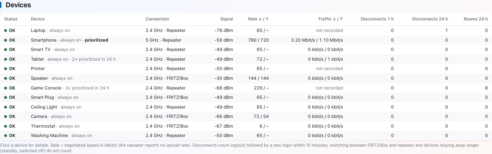
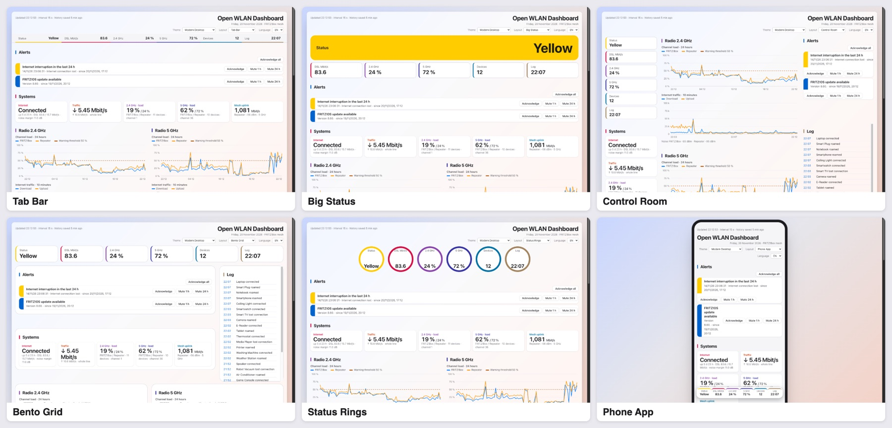

# WLAN Dashboard

Local, read-only health dashboard for a FRITZ!Box mesh (FRITZ!Box + any number of FRITZ!Repeaters or other mesh routers).
It shows the internet line, channel load and traffic per band, link quality per device
and recent WLAN events, and raises alerts early:

- always-on devices going offline
- reconnect loops (roaming between access points is not counted, nor is a device that stays away
  longer than 10 minutes, e.g. in standby)
- weak signal of always-on devices
- crowded or noisy channels
- weak or missing uplink of each mesh router (5 GHz, 2.4 GHz or LAN cable)
- DSL / internet interruptions, radar interruptions on 5 GHz
- FRITZ!Box restarts in the last 24 h (flagged as a likely crash when the box sent an error report)
- stopped history collection, available FRITZ!OS updates


Clicking a device opens its detail page: connection, signal and noise margin, negotiated and
maximum rates, Wi-Fi standard, streams, latency, addresses, 24 h signal and rate history and
all WLAN events of the device.

Devices the FRITZ!Box prioritizes on its own because of real-time traffic such as calls or games
(automatic prioritization, FRITZ!OS 8) are marked in the device list, with the count of the last 24 h.




The screenshots show demo data, no real devices.

WLAN Dashboard includes 100 themes ranging from sci-fi and retro computers to art, places, and
seasons. Modern Desktop is the default selection, and your choice is remembered per browser. Browse the
[THEMES.md](THEMES.md) gallery or see [Themes](#themes) for editing instructions.

Independently of the theme, 20 layouts change the arrangement: tabs, a floating dock, a phone app,
a big status banner, a control room with three columns, a bento grid, a magazine front page, a report,
status rings, a wall display and more. Any theme works with any layout. Except for Classic, a layout
replaces the theme's side bar ornaments with its own form for the status values; colours and fonts
stay with the theme. A layout file starts with `/* layout: Name; de: German name */` and puts its rules
under `html[data-layout="<id>"]:not(#_)`; the `:not(#_)` lifts them above the theme rules.



The page is available in English and German, with English as the default. A language menu next
to the theme menu lets you switch, and your choice is remembered per browser.

Alerts can be acknowledged or muted for 1 h / 24 h; they re-arm automatically when the
problem gets worse, when a mute expires, or when a resolved problem comes back.

Everything runs on your own machine. The dashboard only binds to `127.0.0.1` and only
reads from the FRITZ!Box.

## Files

| File | Purpose |
|---|---|
| `dashboard.py` | The dashboard: web server on http://127.0.0.1:8765, alert logic, data endpoints |
| `web/index.html` | Page markup |
| `web/base.css` | Base design (= the Starship Console theme): layout, shapes, colour variables, phone layout |
| `web/app.js` | Page logic: rendering, charts, detail page, acknowledge/mute, theme and language menus |
| `web/i18n.js` | All page texts in English and German, see [Translations](#translations) |
| `themes/*.css` | One file per theme; the theme menu is built from this folder |
| `layouts/*.css` | One file per layout (arrangement only); the layout menu is built from this folder |
| `collect.py` | Collector for the 24 h history: WLAN log, link quality per device, channel load. Run every 15 min |
| `live.py` | FRITZ!Box access helpers used by the dashboard (also a minimal standalone traffic view) |
| `settings.py`, `.env.example` | Settings: copy `.env.example` to `.env` and adjust, see [Settings](#settings) |
| `launchd/local.wlan-test.collect.plist` | macOS LaunchAgent template that runs `collect.py` every 15 min |

## Requirements

- Python 3.9 or newer, standard library only (the `python3` that ships with macOS is enough)
- macOS for the bundled LaunchAgent; on other systems run `collect.py` every 15 min with cron or similar
- FRITZ!Box with any number of mesh routers; tested with a FRITZ!Box 7530 AX and one FRITZ!Repeater 2700 on FRITZ!OS 8.50
- A current browser (the themes use CSS nesting)

Known limitation: the traffic figures come from the FRITZ!Box online monitor. During large
downloads it can report much more traffic for the computer that runs the dashboard than
actually arrives there (observed up to about three times).

## Setup

1. Create a FRITZ!Box user for the dashboard (System → FRITZ!Box-Benutzer) with
   permission for FRITZ!Box settings. Read access is all the scripts use.
2. Store its password in `~/.claude_fritz` (first line only) and restrict access:

   ```sh
   printf '%s\n' 'the-password' > ~/.claude_fritz && chmod 600 ~/.claude_fritz
   ```

   Box address, user name and password file are settings, see [Settings](#settings); the
   defaults are `192.168.178.1`, `claude` and `~/.claude_fritz`.
3. Start the history collector every 15 minutes (macOS):

   ```sh
   sed "s#/path/to/wlan-dashboard#$PWD#g" launchd/local.wlan-test.collect.plist > ~/Library/LaunchAgents/local.wlan-test.collect.plist
   launchctl bootstrap gui/$(id -u) ~/Library/LaunchAgents/local.wlan-test.collect.plist
   ```

   On first run macOS asks for "Local Network" access for `python3`; allow it
   (System Settings → Privacy & Security → Local Network).
4. Start the dashboard and open http://127.0.0.1:8765:

   ```sh
   python3 dashboard.py
   ```

Self-test of the alert logic: `python3 dashboard.py --selftest`

## Translations

All page texts live in `web/i18n.js` inside a single `I18N` object with `en` and `de` blocks
that have the same keys. Placeholders like `{name}` are filled in by the page. `dashboard.py`
sends alerts as a key plus arguments, not as text; their texts are `a.<key>.t` (title) and
`a.<key>.d` (detail).

To add a language:

1. Copy the `en` block in `web/i18n.js` under a new language code.
2. Translate the values in the new block.
3. Add an `<option>` to the language menu (`id="lang"`) in `web/index.html`. Theme names fall
   back to English.

## Themes

A theme is one CSS file in `themes/`. The server reads the folder on every page load, so a new
or edited theme shows up with a browser reload, no restart needed.

```
themes/
  starship.css     registers Starship Console, the base design in web/base.css
  homecomputer.css /* theme: Home Computer; de: Heimcomputer */  html[data-theme="homecomputer"]{ ... }
  ...
```

### Create a theme

1. Copy a theme that is close to what you want, e.g. `cp themes/desktop.css themes/sunset.css`.
   The file name is the theme id: lowercase letters, digits and `-` only.
2. Line 1 names it in the menu: `/* theme: Sunset; de: Sonnenuntergang */`. The German name is
   optional; without `de:` the English name is used in both languages. Add `; starship` to show
   the starship alarm words ("Yellow Alert", "All systems nominal" / "Gelber Alarm", "Alle
   Systeme nominal") and the stardate in the header; other themes hide the header badge and show
   the normal date. Texts a theme adds in CSS can switch per language with `:lang(de)`, see
   `bahnhof.css`.
3. Put every rule inside `html[data-theme="sunset"]{ ... }`, with the id from the file name.
   Rules for elements use CSS nesting with `&`, e.g. `& .kpi{border-radius:0}`.
4. Reload the dashboard and pick it from the menu. The menu is sorted by name; Starship Console stays first.
5. Add the theme to THEMES.md with a heading in alphabetical order, one or two sentences of
   description, a link to the CSS file, and a screenshot saved as `assets/themes/sunset.jpg`. Use demo
   data for the screenshot; never include real device names.

A theme file may also hold top-level `@keyframes` and `@media` rules (see `radar.css`,
`bahnhof.css`). Prefix keyframe names with the theme id, since all theme files end up in one
stylesheet, and switch animations off under `prefers-reduced-motion`.

Run `python3 dashboard.py --selftest` afterwards: it checks that every theme file has a name.

### Colour variables

Most of a theme is setting these variables; the base design uses them everywhere.

| Variable | Used for |
|---|---|
| `--bg`, `--panel` | page background; cards, alert rows, table rows |
| `--tx`, `--tx2`, `--mut` | main text; secondary text; hints, axis labels |
| `--o1` `--o2` `--pe` `--li` `--pw` `--sk` `--tan` | accent colours: side bar buttons, section headings, card titles, buttons |
| `--on` | text on a filled accent or status colour |
| `--good`, `--warn`, `--crit`, `--info` | status colours: OK (green), warning (**yellow**), critical (**red**), info |
| `--on-warn` | text on the yellow warning colour (keep it dark) |
| `--thr` | warning threshold line in the charts (optional, defaults to `--warn`); set a darker tone on light backgrounds |
| `--s1`, `--s2` | the first two chart lines (download/upload, the first two access points) |
| `--grid`, `--axis` | chart grid and axis lines |
| `--font`, `--head` | body font; font for headings, numbers and the side bar |
| `--big` | font size of the big numbers in summary cards (default 40px); themes set this instead of styling `.big` directly |
| `--big-fit` | max width share of a card for big numbers in `cqi` units (default 22cqi); use lower values (11–21cqi) for wide fonts to prevent clipping |

Fonts come from Google Fonts; add a new family to the font link in `web/index.html`.

### Shapes

Beyond colours, a theme can restyle any part of the page. The main classes:

| Class | Part of the page |
|---|---|
| `.rail`, `.elbow`, `.pill`, `.fill` | side bar: corner pieces, buttons, filler |
| `.main > .bar` | coloured bars above and below the content |
| `.alarm` | header badge (only visible in `starship` themes) |
| `.hb` with `::before` / `::after` | section headings and their decorations |
| `.kpi`, `.big`, `.sm` | summary cards, big numbers, small text |
| `.alert`, `.alert .tag`, `.btn` | alert rows, their colour field, buttons |
| `.chart`, `.ln`, `.th`, `.tip` | charts, lines, threshold line, tooltip |
| `table`, `th`, `td`, `.st` | device list, status word |
| `.log`, `.info` | event log, detail page data list |

Set `display` on `.rail` only to hide it (`none`); the phone layout hides it below 900 px width,
and any other value would show it there again.

### Rules of thumb

- Warning stays yellow and critical stays red in every theme; the colour field in front of an
  alert carries no text.
- Text needs a contrast of at least 4.5:1 against its background, the threshold line 3:1.
  Light themes need darker accent colours for text (card titles, table headers) than for fills.
- Check the overview, a device detail page (click a device) and a phone-width window.

## Settings

All settings live in `.env` next to `dashboard.py`: copy `.env.example` to `.env` and change what you
need. Every setting is optional and has the default shown in `.env.example`; an environment variable of
the same name wins over the file. `.env` is git-ignored because it may hold the password and MAC addresses.

- **FRITZ!Box access:** `FRITZ_HOST`, `FRITZ_USER`, and the password either as `FRITZ_PASSWORD` or
  (default) in the file `FRITZ_PASSWORD_FILE`.
- **Mesh routers:** the box shows as "FRITZ!Box", every other mesh router with its name from the box.
  `MESH_NAMES=fritzrepeaterkeller=Cellar,...` gives them shorter names. Charts, key figures and the
  device list show one entry per router, and each router's uplink is checked on its own.
- **Dashboard:** `DASHBOARD_PORT`, `POLL_S` (refresh interval). The dashboard always binds to `127.0.0.1` only.
- **Alert thresholds:** channel load, noise, signal, disconnects per hour, mesh uplink, DSL noise margin,
  collector and restart times, and the windows for roaming and reconnects.
- **Always-on detection:** `ALWAYS_ON_SHARE`, `ALWAYS_ON_MIN_SAMPLES`, and `NEVER_ALWAYS_ON`, a
  comma-separated list of MAC addresses that never count as always-on (e.g. a game console that is
  often switched off); they raise no offline or weak-signal alerts.

Restart `dashboard.py` after changing `.env`; the collector reads it on its next run.

## Private data — never commit

The collector and the dashboard write MAC addresses, device names and network events into
this directory (`*.csv`, `*.jsonl`, `*.log`, `acks.json`, `alerts.json`) and the settings in `.env`. They are excluded via
`.gitignore`, as is the password file. Python standard library only, no dependencies.

## License

MIT, see [LICENSE](LICENSE).
