# Themes

The dashboard ships with 100 themes. Pick one in the header of the page; the choice is remembered
per browser. Modern Desktop is the default. How to edit a theme or add your own is described in the
[README](README.md#themes). Any theme can be combined with any of the 20 [layouts](README.md#layouts).

The screenshots show demo data (no real devices). Animated themes (Alien Biotech, Art Nouveau, CMYK Print, Candy Shop, Chart Recorder, Christmas, Cinema Marquee, Circus, Crystal Glass, Departure Board, Digital Rain, Film Negative, Floppy Disk, Harbour at Night, Jazz Record, Jigsaw Puzzle, Kite Day, Library, Mechanical Keyboard, Moss and Stone, Nebula, Neon Rain, Northern Lights, Ocean, Pinball, Punch Card, Radar, Rainy Day, Sci-Fi Holo, Server Room, Spring, Steampunk, Terminal, Video Recorder, Volcano, Winter)
stop moving when the system setting "reduce motion" is on.

[70s Disco](#70s-disco) · [90s Desktop](#90s-desktop) · [Action Painting](#action-painting) · [Adventure Parchment](#adventure-parchment) · [Alien Biotech](#alien-biotech) · [Alpine](#alpine) · [Art déco](#art-déco) · [Art Nouveau](#art-nouveau) · [Atomic Age](#atomic-age) · [Autumn](#autumn) · [Battle Cruiser](#battle-cruiser) · [Bauhaus](#bauhaus) · [Birthday Party](#birthday-party) · [Blueprint](#blueprint) · [Botanical Garden](#botanical-garden) · [Brutalism](#brutalism) · [Candy Shop](#candy-shop) · [Cassette Tape](#cassette-tape) · [Chalkboard](#chalkboard) · [Chart Recorder](#chart-recorder) · [Christmas](#christmas) · [Cinema Marquee](#cinema-marquee) · [Circuit Board](#circuit-board) · [Circus](#circus) · [Clapperboard](#clapperboard) · [CMYK Print](#cmyk-print) · [Cockpit](#cockpit) · [Coffee House](#coffee-house) · [Collage](#collage) · [Constructivism](#constructivism) · [Crystal Glass](#crystal-glass) · [Departure Board](#departure-board) · [Desert Canyon](#desert-canyon) · [Digital Rain](#digital-rain) · [Dot Matrix Printout](#dot-matrix-printout) · [Film Negative](#film-negative) · [Floppy Disk](#floppy-disk) · [Forest](#forest) · [Futuristic](#futuristic) · [Ham Radio](#ham-radio) · [Handheld](#handheld) · [Harbour at Night](#harbour-at-night) · [Home Computer](#home-computer) · [Jazz Record](#jazz-record) · [Jigsaw Puzzle](#jigsaw-puzzle) · [Kite Day](#kite-day) · [Knights](#knights) · [Library](#library) · [Light Grid](#light-grid) · [Mechanical Keyboard](#mechanical-keyboard) · [Miniature City](#miniature-city) · [Modern Desktop](#modern-desktop) · [Moss and Stone](#moss-and-stone) · [Museum](#museum) · [Nebula](#nebula) · [Neon Rain](#neon-rain) · [Newspaper](#newspaper) · [Northern Lights](#northern-lights) · [Notepad](#notepad) · [Ocean](#ocean) · [Op Art](#op-art) · [Origami](#origami) · [Pinball](#pinball) · [Pop Art](#pop-art) · [Post Office](#post-office) · [Post-Apocalyptic](#post-apocalyptic) · [Primary Grid](#primary-grid) · [Punch Card](#punch-card) · [Radar](#radar) · [Rainy Day](#rainy-day) · [Receipt Printer](#receipt-printer) · [Retro 8Bit](#retro-8bit) · [Retro RPG](#retro-rpg) · [Robot Factory](#robot-factory) · [Sci-Fi Holo](#sci-fi-holo) · [Server Room](#server-room) · [Slide Rule](#slide-rule) · [Spellbook](#spellbook) · [Spiral House](#spiral-house) · [Spring](#spring) · [Starship Console](#starship-console) · [Steampunk](#steampunk) · [Street Art](#street-art) · [Subway Map](#subway-map) · [Summer](#summer) · [Swiss Style](#swiss-style) · [Synthwave](#synthwave) · [Terminal](#terminal) · [Tropical Jungle](#tropical-jungle) · [Ukiyo-e](#ukiyo-e) · [Unicorn](#unicorn) · [Video Recorder](#video-recorder) · [Vintage Airline](#vintage-airline) · [Vintage Soda](#vintage-soda) · [Volcano](#volcano) · [Western](#western) · [Winter](#winter) · [Wood Console](#wood-console) · [Woodworker](#woodworker) · [Zen](#zen)

## 70s Disco

Uses brown, orange, and mustard colours with 70s stripes. Features mirror-ball sparkle effects, round shapes, and a chunky rounded font for a retro vibe.

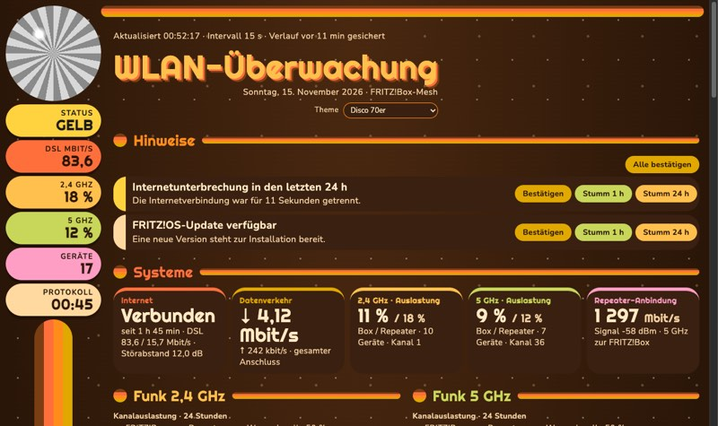

File: [`themes/disco.css`](themes/disco.css)

## 90s Desktop

Mimics a 1990s desktop with a teal background and grey bevelled windows. Features a navy title bar, start menu side bar, and white list view.

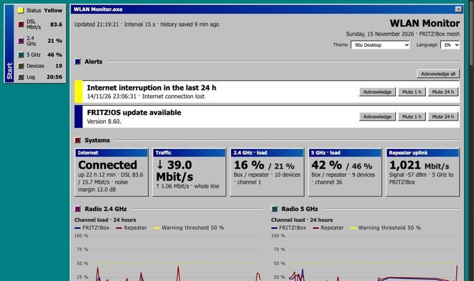

File: [`themes/desktop90s.css`](themes/desktop90s.css)

## Action Painting

Frames off-white canvases with paint splatters and drips in red, blue, black, and yellow. Cards have brush-stroke borders, while expressive hand-painted headings add artistic flair.

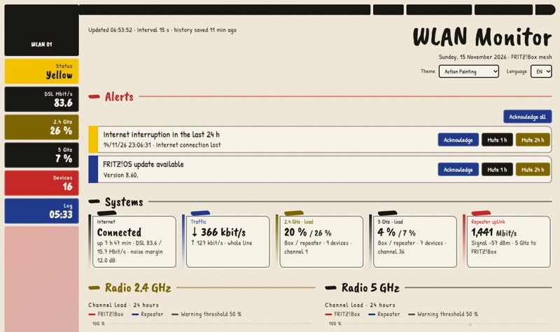

File: [`themes/actionpainting.css`](themes/actionpainting.css)

## Adventure Parchment

Resembles a fantasy adventure map on parchment with dark edges. Features gold-framed cards, heart symbols, and a palette of forest green and gold.

File: [`themes/parchment.css`](themes/parchment.css)

## Alien Biotech

Frames very dark green-black backgrounds with cell-like blob patterns and glossy organic cards. Iridescent teal-to-violet borders surround neon lime and teal accents for an alien laboratory aesthetic.

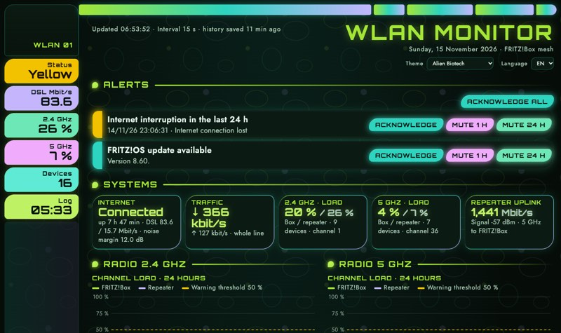

File: [`themes/alienbiotech.css`](themes/alienbiotech.css)

## Alpine

Frames pale sky blue areas with layered mountain silhouettes at the bottom. Uses white cards with red huts, sturdy sans headings, and pine green accents.

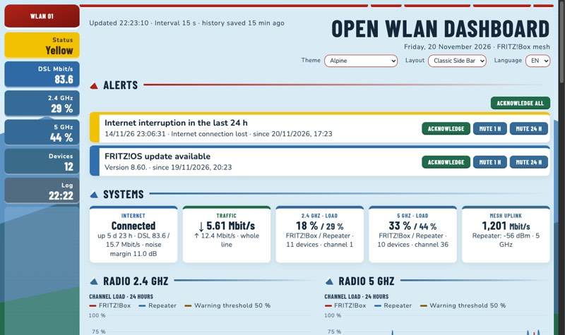

File: [`themes/alpine.css`](themes/alpine.css)

## Art déco

Uses black and gold with sunburst rays. Features double gold frames with stepped corners and slim geometric capitals for a classic decorative style.

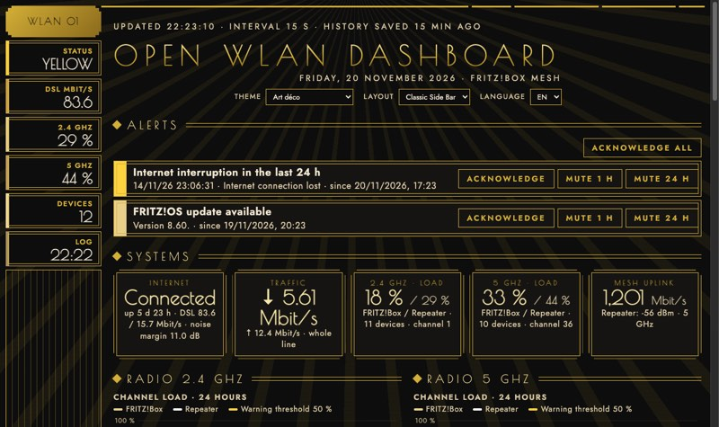

File: [`themes/artdeco.css`](themes/artdeco.css)

## Art Nouveau

Shows a cream background with flowing whiplash curves and arched gold-framed cards. Uses elegant decorative headings in sage green, plum, and gold tones.

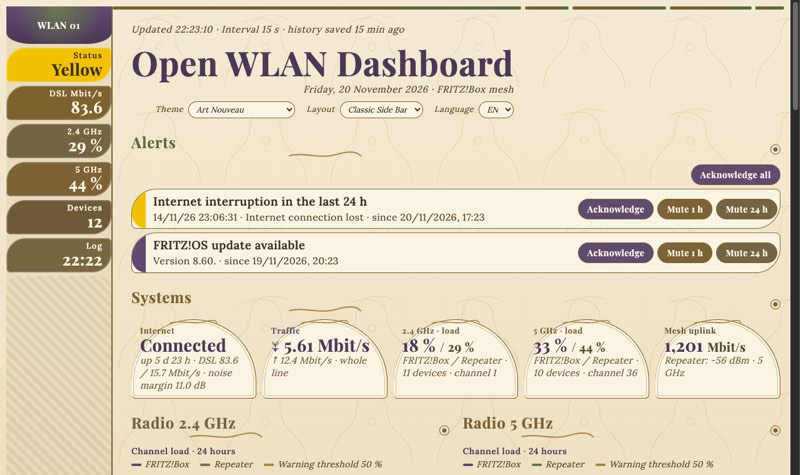

File: [`themes/artnouveau.css`](themes/artnouveau.css)

## Atomic Age

Frames pastel pink and mint backgrounds with atom starbursts and rounded chrome-bordered cards. Bubbly headings use turquoise and coral accents alongside boomerang shapes for a retro-future look.

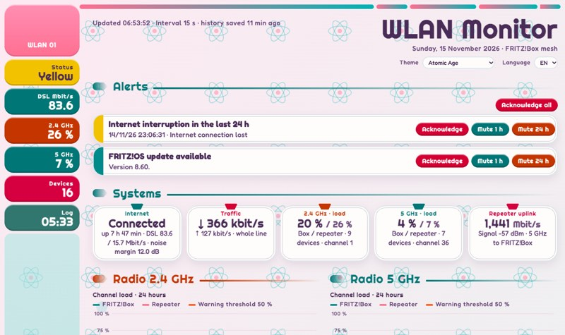

File: [`themes/atomicage.css`](themes/atomicage.css)

## Autumn

Uses warm paper tones with maple red, pumpkin, and mustard colours. Scattered leaves decorate the interface alongside elegant serif headings for a seasonal appearance.

File: [`themes/autumn.css`](themes/autumn.css)

## Battle Cruiser

Uses black, blood red, and bronze with angular cut corners and blade shapes. Features military stencil headings, stardates, and alarm words.

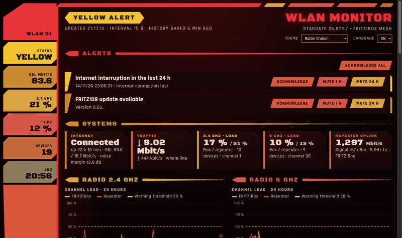

File: [`themes/battlecruiser.css`](themes/battlecruiser.css)

## Bauhaus

Presents primary colours on paper with geometric sans-serif fonts. Lower-case headings are accompanied by circle, square, or triangle shapes for each section.

File: [`themes/bauhaus.css`](themes/bauhaus.css)

## Birthday Party

Uses light backgrounds with confetti and balloons. Shows bunting-topped cards and playful rounded headings in red, blue, and sunny yellow tones.

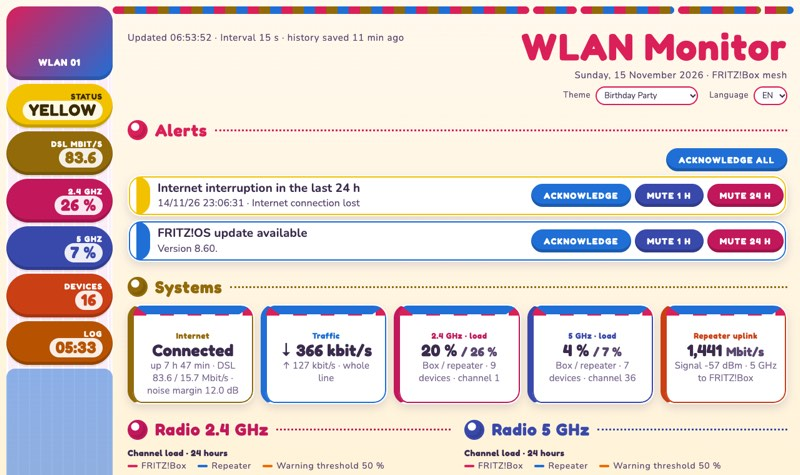

File: [`themes/birthday.css`](themes/birthday.css)

## Blueprint

Resembles a construction plan with white lines on blue paper. Includes a drafting grid, dimension lines under headings, and a title block.

File: [`themes/blueprint.css`](themes/blueprint.css)

## Botanical Garden

Uses ivory backgrounds with fine leaf line drawings. Features white cards with thin green borders, elegant serif headings, and fern, rose, and ochre accents.

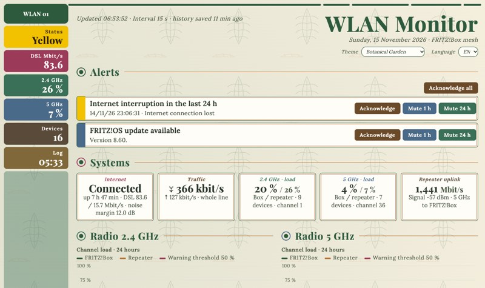

File: [`themes/botanical.css`](themes/botanical.css)

## Brutalism

Sets a raw concrete background with heavy cards featuring thick borders and hard shadows. Bold uppercase headings stand out against grey tones, punctuated by one signal orange accent.

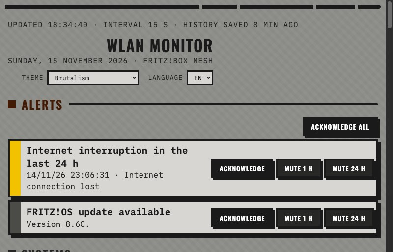

File: [`themes/brutalism.css`](themes/brutalism.css)

## Candy Shop

Uses a pastel pink background with sprinkles. Features rounded cards with candy-stripe borders, bubbly headings, and strawberry pink, mint, and lemon accent colors.

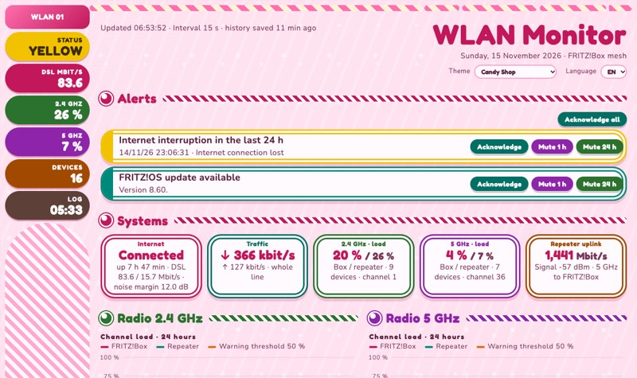

File: [`themes/candy.css`](themes/candy.css)

## Cassette Tape

Frames light cards on a dark brown-black background. Each card has a coloured left stripe, with rounded headings in orange, cream and brown tones.

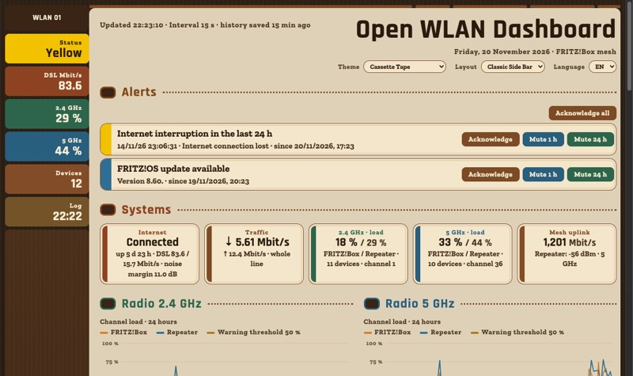

File: [`themes/cassette.css`](themes/cassette.css)

## Chalkboard

Looks like a slate board with chalk dust and a wooden frame. Uses coloured chalk for hand-drawn lines and lettering throughout the dashboard.

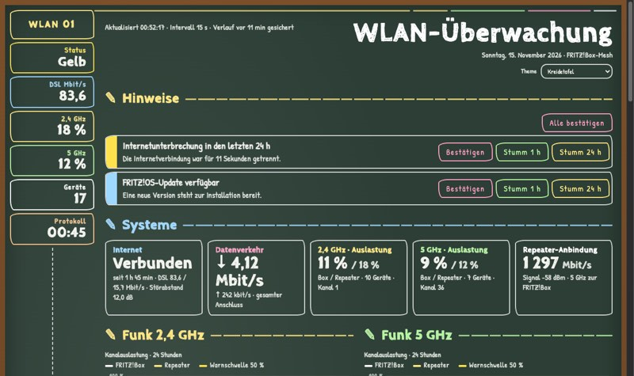

File: [`themes/chalkboard.css`](themes/chalkboard.css)

## Chart Recorder

Shows white paper with a light red grid and perforated paper strips. Uses technical monospace headings with red and blue pen line accents.

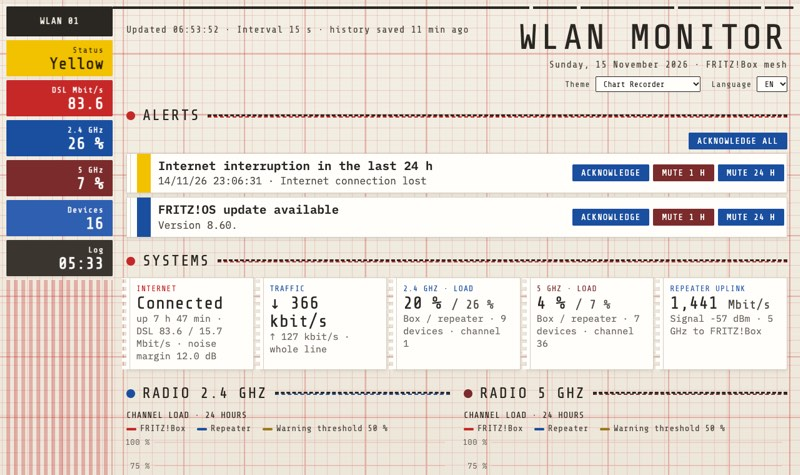

File: [`themes/chartrecorder.css`](themes/chartrecorder.css)

## Christmas

Displays fir green night skies with falling snow. Features gingerbread cards with icing, ornaments, garlands, and candy-cane buttons for a festive theme.

File: [`themes/christmas.css`](themes/christmas.css)

## Cinema Marquee

Shows dark red velvet backgrounds with ticket-style cards featuring gold borders and perforated edges. Headings are framed by rows of light-bulb dots, using warm yellow and white accents throughout.

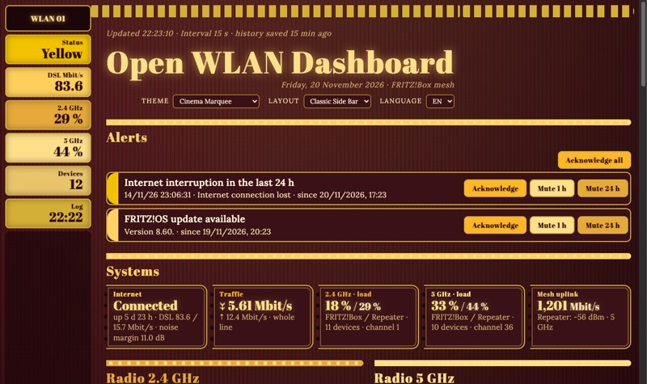

File: [`themes/cinema.css`](themes/cinema.css)

## Circuit Board

Resembles a green PCB with gold traces and vias. Cards look like black chips with pins, while copper pads serve as buttons.

File: [`themes/circuit.css`](themes/circuit.css)

## Circus

Uses cream content areas framed by red tent stripes. Features scalloped pennant cards and star-shaped poster headings in gold and royal blue.

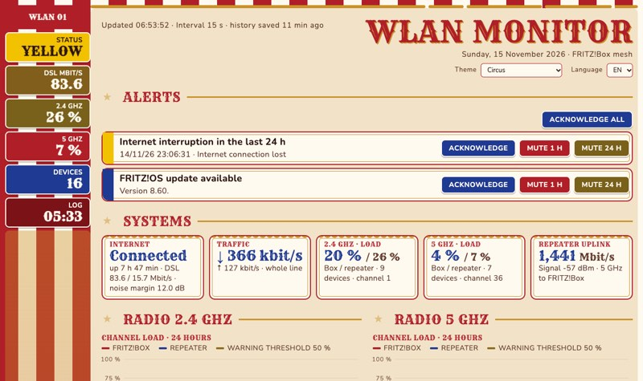

File: [`themes/circus.css`](themes/circus.css)

## Clapperboard

Uses dark charcoal backgrounds with clapperboard-style cards featuring black-and-white striped top bands. White chalk-style headings appear on slate grey surfaces, accented by yellow tape details.

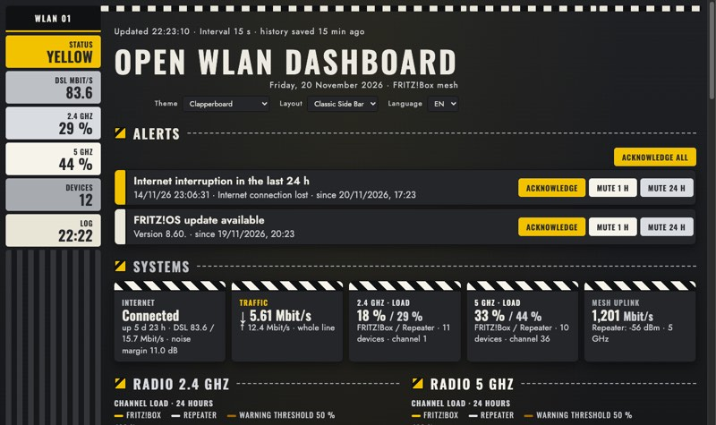

File: [`themes/clapperboard.css`](themes/clapperboard.css)

## CMYK Print

Sets white paper backgrounds with crop marks and top colour bars. Uses bold sans headings and cyan-magenta accents to resemble a professional print proof sheet.

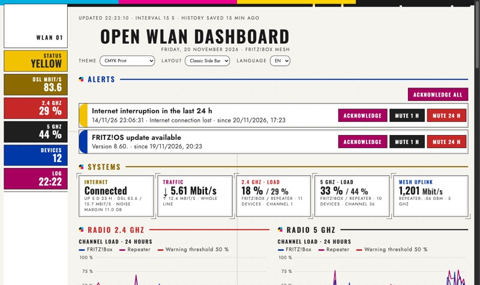

File: [`themes/cmyk.css`](themes/cmyk.css)

## Cockpit

Mimics an aircraft instrument panel with a grey surface and screws. Black displays show green and amber readouts alongside annunciator lights.

File: [`themes/cockpit.css`](themes/cockpit.css)

## Coffee House

Uses cream and espresso brown tones with coffee ring stains. Features menu-card typography with dotted leaders for a warm, traditional cafe atmosphere.

File: [`themes/coffeehouse.css`](themes/coffeehouse.css)

## Collage

Uses kraft paper backgrounds with torn, rotated cards secured by tape strips. Mixed cut-out letter headings appear in muted red, ochre, and teal, creating a layered paper effect.

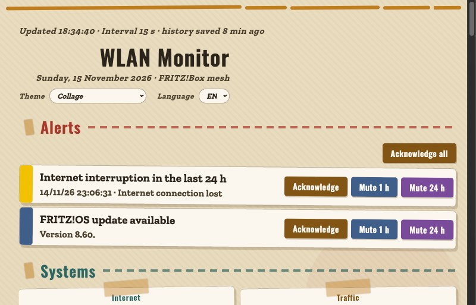

File: [`themes/collage.css`](themes/collage.css)

## Constructivism

Sets an off-white background with bold red diagonal bands and black wedges. Features sharp-edged cards with red corners and bold condensed italic headings.

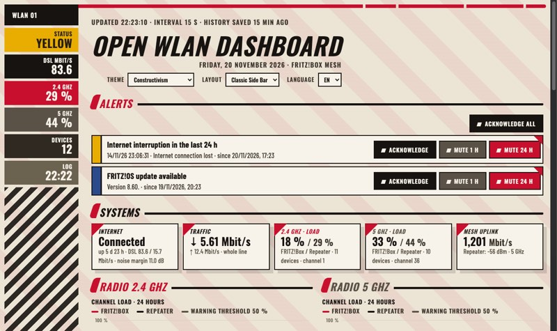

File: [`themes/constructivism.css`](themes/constructivism.css)

## Crystal Glass

Frames dark blue-grey space with faceted glass cards showing prismatic rainbow edges. Uses thin elegant headings with ice blue and soft rainbow accents.

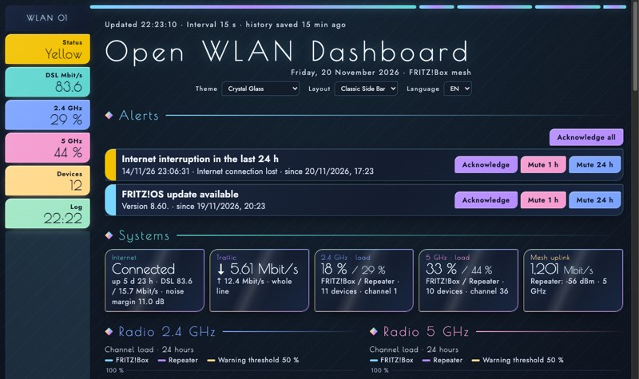

File: [`themes/crystal.css`](themes/crystal.css)

## Departure Board

Mimics a split-flap departure board where values sit on black tiles that flip on refresh. Headings appear as blue station signs with small 'Track' plates.

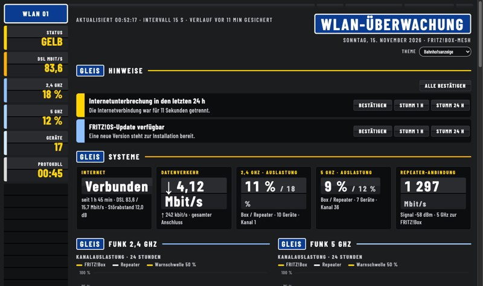

File: [`themes/bahnhof.css`](themes/bahnhof.css)

## Desert Canyon

Frames warm sand backgrounds with layered rock strata bands. Light sandstone cards have rough edges, accompanied by earthy slab headings in terracotta, rust, and sage tones.

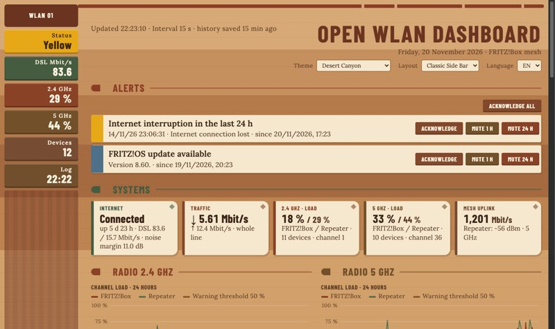

File: [`themes/canyon.css`](themes/canyon.css)

## Digital Rain

Displays a black screen with slowly falling green glyphs behind the page. Text glows green for a digital rain effect.

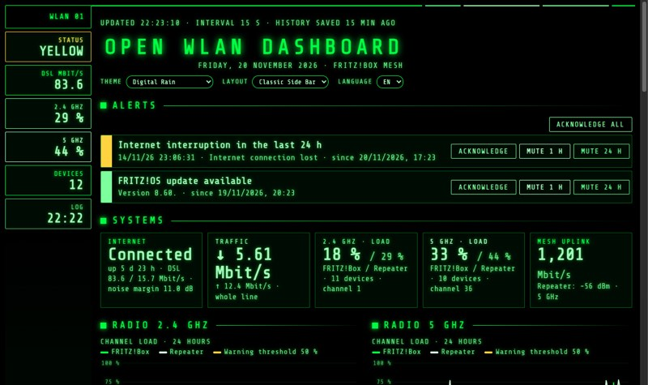

File: [`themes/digitalrain.css`](themes/digitalrain.css)

## Dot Matrix Printout

Shows pale green-striped paper with tractor-feed holes along the side. Features dot-matrix monospace text in black ink with faded blue accents for printed sheets.

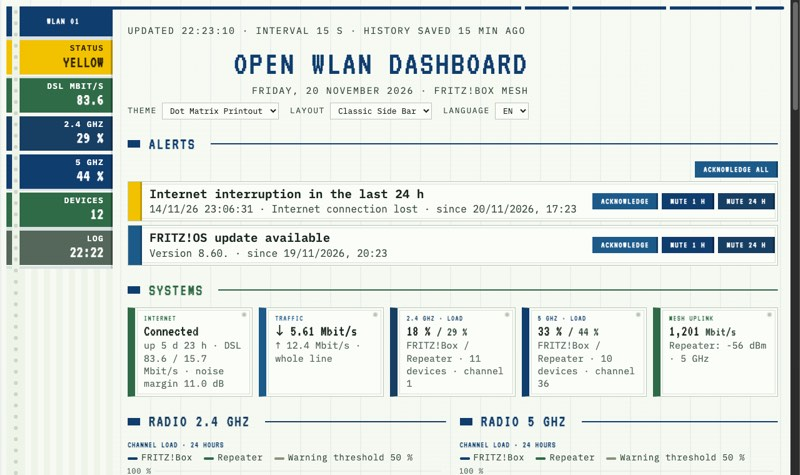

File: [`themes/dotmatrix.css`](themes/dotmatrix.css)

## Film Negative

Mimics a thirty-five millimeter film strip with dark amber translucent backgrounds and side sprocket holes. Film frame cards have thin light borders, white condensed headings, and cyan or magenta accents.

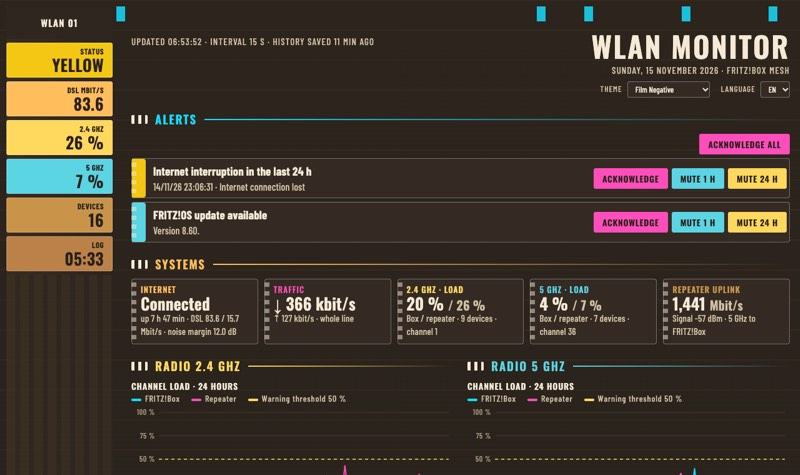

File: [`themes/filmnegative.css`](themes/filmnegative.css)

## Floppy Disk

Frames light labels on a dark blue plastic background. Cards look like white ruled sheets with metal shutters, using simple sans headings and silver-red details.

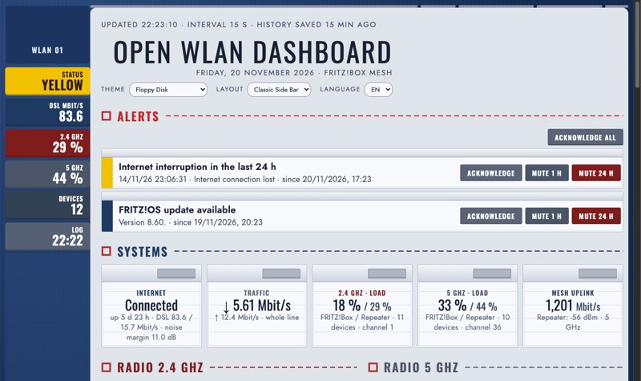

File: [`themes/floppy.css`](themes/floppy.css)

## Forest

Depicts a dark forest floor with light shafts through the canopy. Uses moss and bark colours alongside leaf shapes for a natural aesthetic.

File: [`themes/forest.css`](themes/forest.css)

## Futuristic

Shows dark neon in cyan and magenta over a faint grid. Features translucent glass cards, glowing outlines, and gradient titles in a wide font.

File: [`themes/futuristic.css`](themes/futuristic.css)

## Ham Radio

Resembles a valve radio at night with dark bakelite and brass. Features warm amber dial glow, frequency scales, and Morse-code markers.

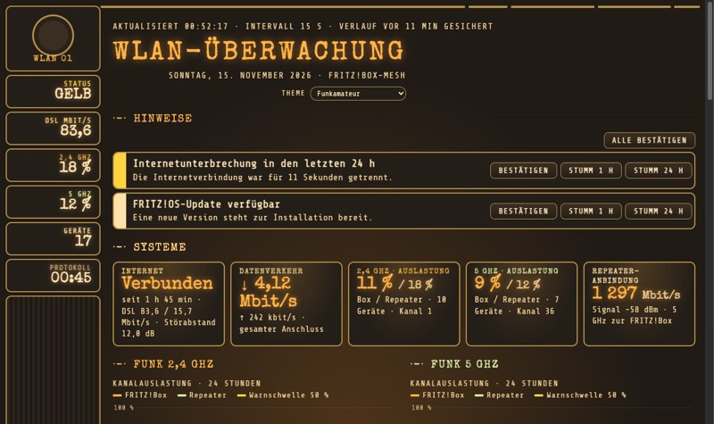

File: [`themes/hamradio.css`](themes/hamradio.css)

## Handheld

Mimics a grey handheld with a dark bezel around a four-shade green dot-matrix screen. Includes magenta A/B buttons and a pixel font.

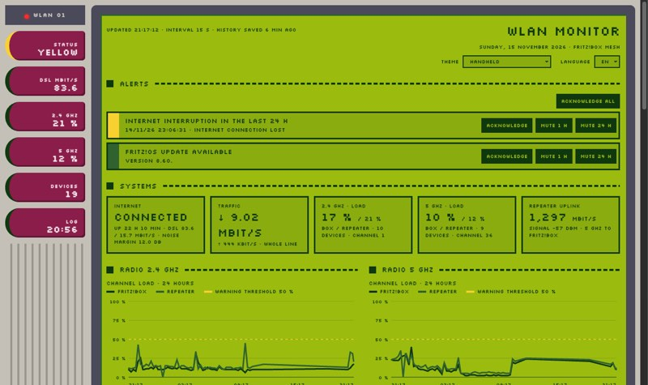

File: [`themes/handheld.css`](themes/handheld.css)

## Harbour at Night

Sets dark navy water with orange reflections behind weathered wooden pier boards. Uses lighthouse glows, condensed sans headings, and sodium orange or rope beige accents.

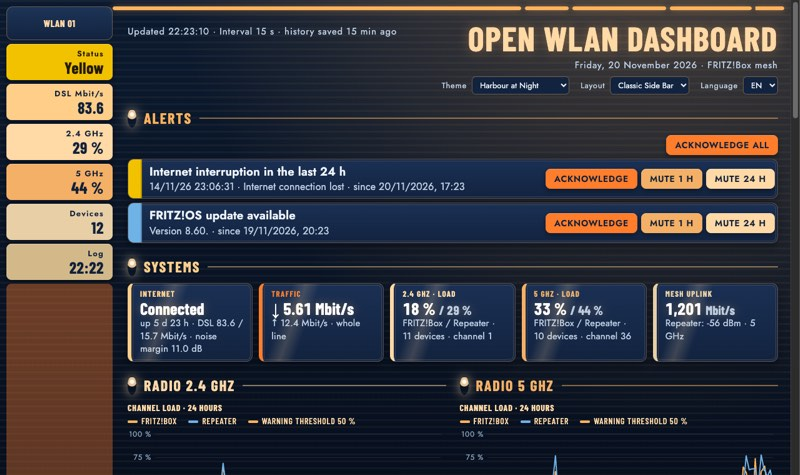

File: [`themes/harbour.css`](themes/harbour.css)

## Home Computer

Features a blue screen with a white title bar reading '512K chip RAM free'. Windows have white frames, striped drag bars, square bevelled gadgets, and a narrow pixel terminal font.

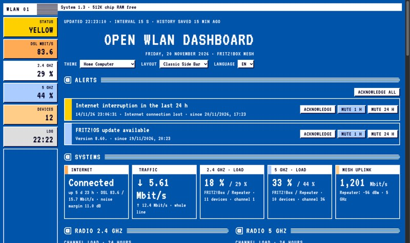

File: [`themes/homecomputer.css`](themes/homecomputer.css)

## Jazz Record

Uses near-black backgrounds with faint grooves and mustard, teal, or orange accents. Cards resemble sleeves with colored blocks and circular labels, topped by condensed bold headings.

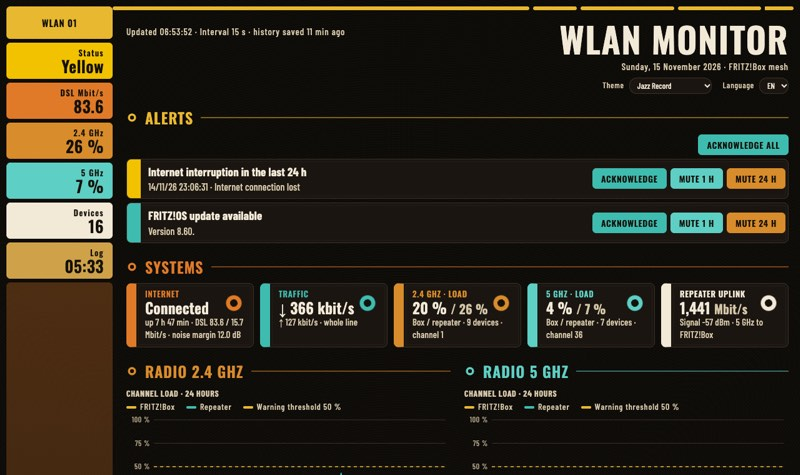

File: [`themes/jazz.css`](themes/jazz.css)

## Jigsaw Puzzle

Displays light wooden tables behind puzzle-piece cards. Features rounded headings with bright mixed colors and blue or orange accents on the tabs.

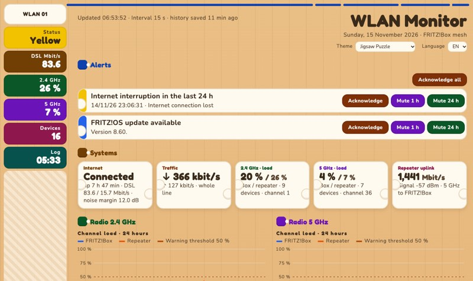

File: [`themes/jigsaw.css`](themes/jigsaw.css)

## Kite Day

Sets bright sky blues with soft clouds. Features diamond kite shapes before headings and white rounded cards with red, yellow, and green accents.

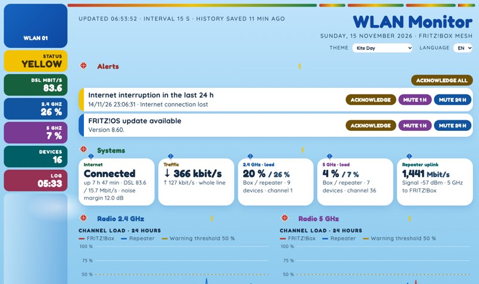

File: [`themes/kite.css`](themes/kite.css)

## Knights

Sets grey stone walls behind heraldic shield cards. Displays blackletter headings with red, blue, and gold accents for a medieval castle look.

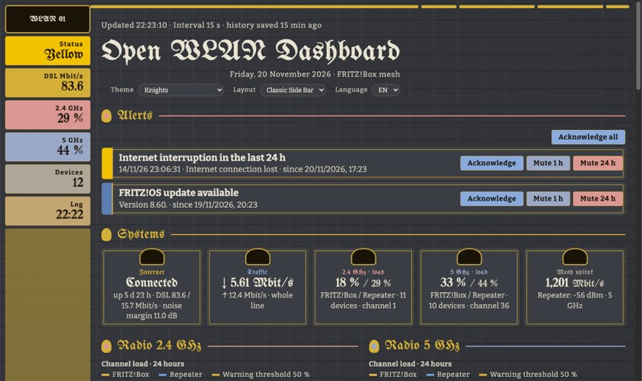

File: [`themes/knights.css`](themes/knights.css)

## Library

Sets dark wood shelves with book spines behind leather-bound cards. Features gold tooling borders, classic serif headings, and deep green or burgundy accents.

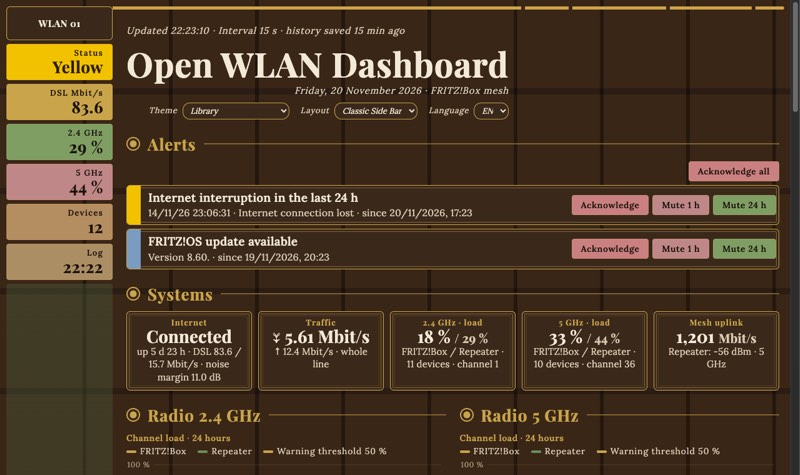

File: [`themes/library.css`](themes/library.css)

## Light Grid

Features a black grid world with cyan light lines and orange accents. Includes cut corners and a glowing grid floor extending to the horizon.

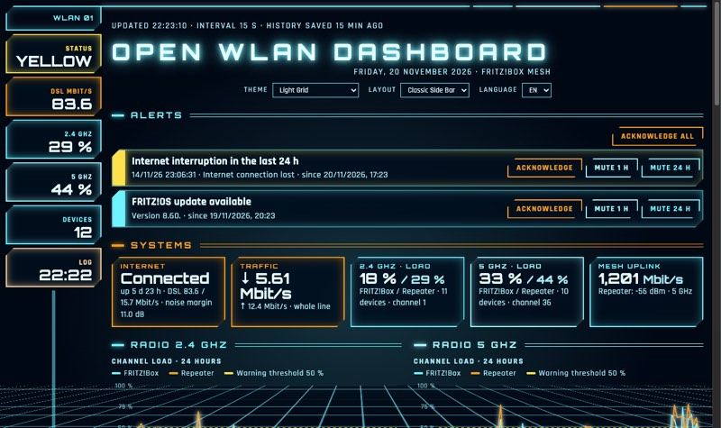

File: [`themes/lightgrid.css`](themes/lightgrid.css)

## Mechanical Keyboard

Frames light ivory keycaps on a dark grey aluminium plate. Cards have raised bevels and shadows, using sans legends with red escape-key and grey modifier accents.

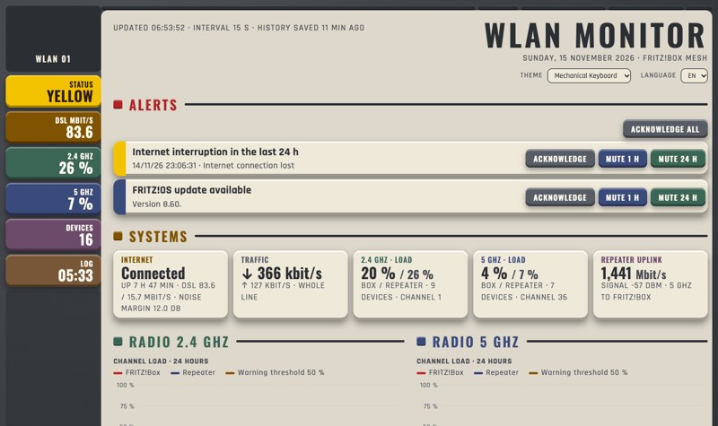

File: [`themes/keyboard.css`](themes/keyboard.css)

## Miniature City

Uses light green isometric street grids with flat white building cards and drop shadows. Small house icons precede headings, while toy primary colors add playful contrast to the scene.

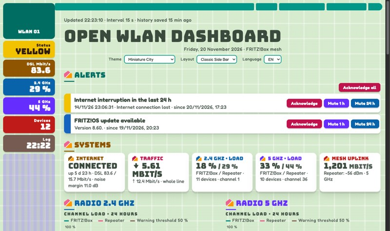

File: [`themes/minicity.css`](themes/minicity.css)

## Modern Desktop

Resembles a light, modern desktop window with three coloured dots. Features a side bar with coloured dots, white rounded cards, system fonts, and standard system colours. It is the default theme.

File: [`themes/desktop.css`](themes/desktop.css)

## Moss and Stone

Frames dark stone backgrounds with moss patches around light content. Uses smooth pebble-like cards in light grey, earthy serif headings, and lichen yellow accents.

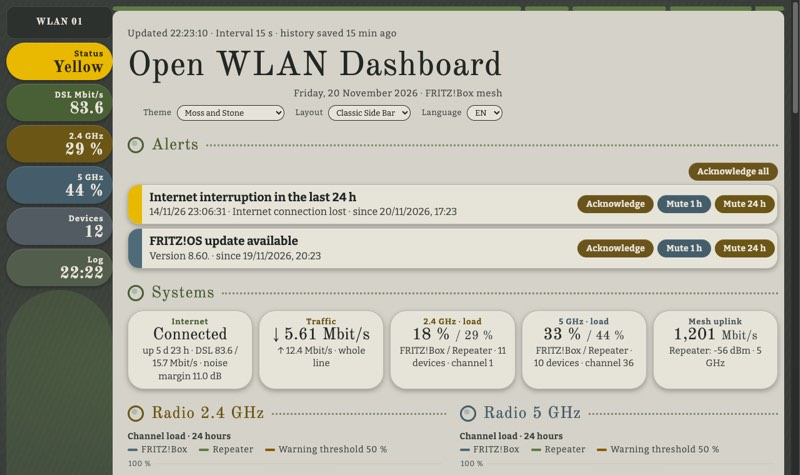

File: [`themes/moss.css`](themes/moss.css)

## Museum

Frames warm grey walls with framed pictures acting as cards. Uses white mats, thin gold frames, elegant serif headings, and small label plates for context.

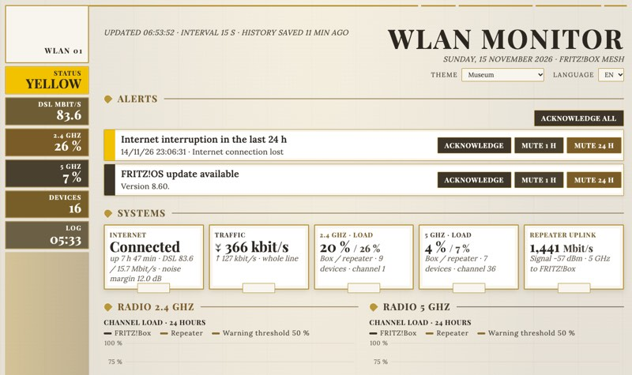

File: [`themes/museum.css`](themes/museum.css)

## Nebula

Sets swirling violet, magenta, and blue gas clouds behind translucent dark cards with soft glowing edges. Wide futuristic headings use pink and violet accents against a deep space starfield background.

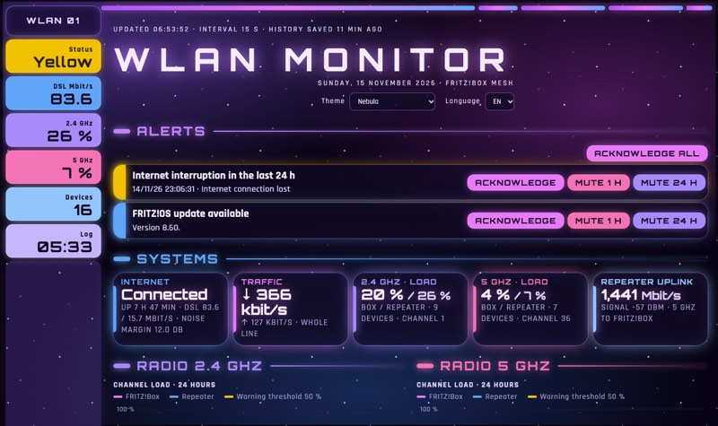

File: [`themes/nebula.css`](themes/nebula.css)

## Neon Rain

Features a rainy neon night with pink and cyan lights on dark backgrounds. Drifting rain, fog, and hologram scan lines appear on the cards.

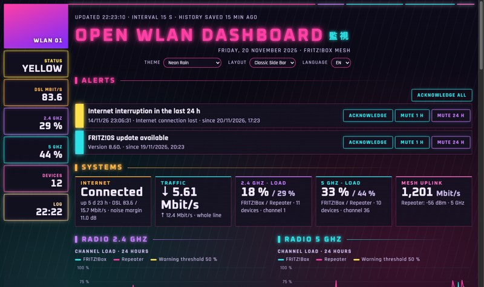

File: [`themes/neonrain.css`](themes/neonrain.css)

## Newspaper

Mimics a front page with paper tones and a blackletter masthead. Features serif text in columns separated by rules, using ink black with a red accent and no side bar.

File: [`themes/newspaper.css`](themes/newspaper.css)

## Northern Lights

Shows a night sky with stars and slowly moving green-violet northern lights. Icy glass cards complete the look.

File: [`themes/aurora.css`](themes/aurora.css)

## Notepad

Resembles lined paper with a red margin and handwriting. Includes highlighter colours, index cards, and taped notes for a casual, analog feel.

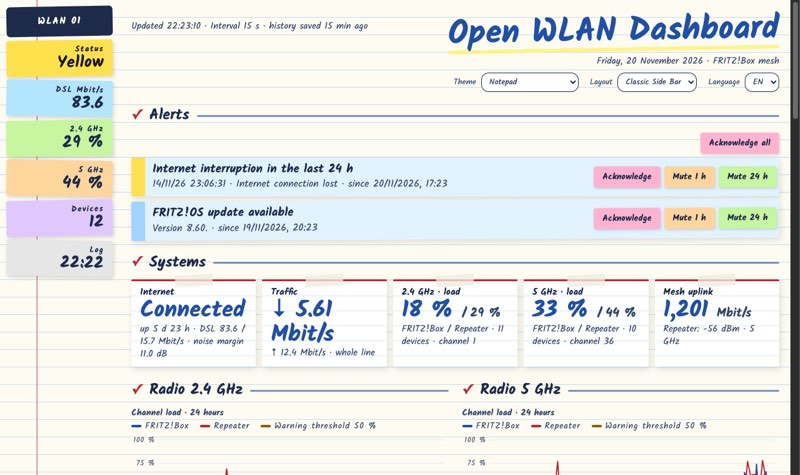

File: [`themes/notepad.css`](themes/notepad.css)

## Ocean

Depicts deep sea with a blue water gradient and rising bubbles. Features coral and sea-foam accents, rounded glass cards, and wavy lines.

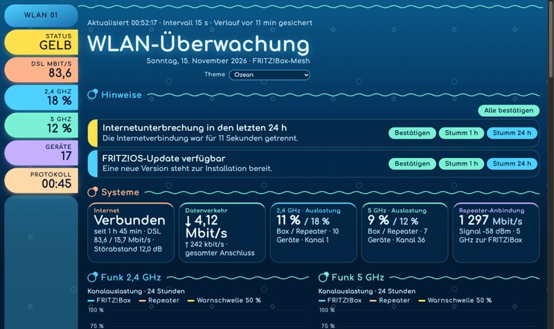

File: [`themes/ocean.css`](themes/ocean.css)

## Op Art

Shows black and white striped patterns around plain white content areas. High-contrast cards feature bold geometric headings, using vivid blue and red accents for visual impact.

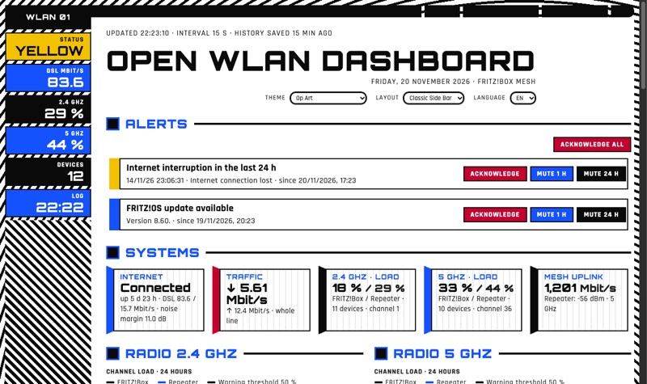

File: [`themes/opart.css`](themes/opart.css)

## Origami

Uses a light warm white background with folded paper cards and diagonal shading. Features small paper-crane icons, minimal sans headings, and coral, teal, indigo accents.

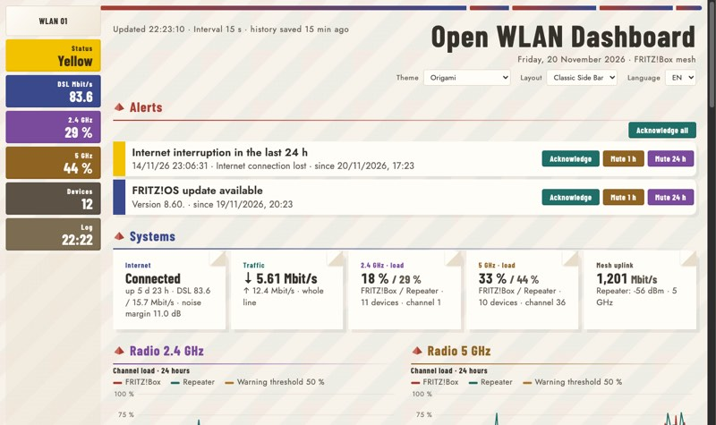

File: [`themes/origami.css`](themes/origami.css)

## Pinball

Frames a dark playfield with lit star inserts. Uses chrome rail cards with glowing edges and bold arcade headings in red, yellow, and blue.

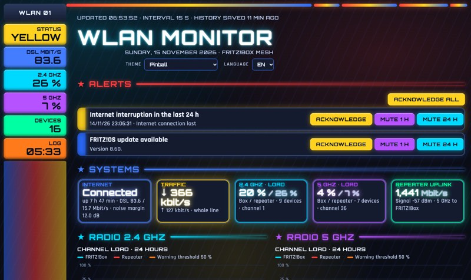

File: [`themes/pinball.css`](themes/pinball.css)

## Pop Art

Features a comic look with halftone dots, loud colours, and thick black outlines. Includes hard offset shadows and speech-bubble alerts for a bold aesthetic.

File: [`themes/popart.css`](themes/popart.css)

## Post Office

Uses light paper backgrounds with faint airmail stripes behind stamp-like cards. Features perforated edges, round postmarks before serif headings, and postal red or blue accents.

File: [`themes/postoffice.css`](themes/postoffice.css)

## Post-Apocalyptic

Sets a rusty corrugated metal backdrop behind torn cardboard cards with rough edges. Stencil headings sit above hazard stripes, using rust orange and dusty khaki accents on the light content area.

File: [`themes/postapocalyptic.css`](themes/postapocalyptic.css)

## Primary Grid

Uses thick black grid lines separating red, blue, and yellow fields. Every card carries a distinct colour block on top for a geometric abstract look.

File: [`themes/primarygrid.css`](themes/primarygrid.css)

## Punch Card

Mimics beige card stock with cut corners and rectangular holes. Uses typewriter headings and dark blue-red print accents like 1960s office data cards.

File: [`themes/punchcard.css`](themes/punchcard.css)

## Radar

Mimics a green phosphor radar screen with range rings and a rotating sweep behind the page. Cards feature targeting corners.

File: [`themes/radar.css`](themes/radar.css)

## Rainy Day

Sets a cool grey-blue rainy window background framing light content. Shows frosted glass pane cards, soft sans headings, and slate blue, umbrella yellow, and teal accents.

File: [`themes/rainyday.css`](themes/rainyday.css)

## Receipt Printer

Sets a light grey background behind white strips with zigzag torn edges. Features dashed separators, monospace text in black, and faded purple accents.

File: [`themes/receipt.css`](themes/receipt.css)

## Retro 8Bit

Features an 8-bit game look with pixel fonts and a 16-colour palette. Includes square corners, hard drop shadows, bevelled buttons, and faint CRT scan lines.

File: [`themes/retro.css`](themes/retro.css)

## Retro RPG

Uses red, white, blue, and yellow like a retro handheld role-playing game. Features menu frames with double edges, 3D buttons, and a star before each heading.

File: [`themes/rpg.css`](themes/rpg.css)

## Robot Factory

Mimics an assembly line with steel grey gears. Features metal plate cards with bolts and chunky mechanical headings in orange, yellow, and teal.

File: [`themes/robotfactory.css`](themes/robotfactory.css)

## Sci-Fi Holo

Displays floating cyan holograms with translucent cards featuring scan lines and cut corners. A projector cone of light and gentle flicker are included.

File: [`themes/holo.css`](themes/holo.css)

## Server Room

Sets deep navy backgrounds with rack lines and vent slits on panels. Uses monospace headings and blinking cyan-green LEDs to mimic a data centre environment.

File: [`themes/serverroom.css`](themes/serverroom.css)

## Slide Rule

Uses a warm wood background framing ivory-white cards with fine tick scales. Features condensed serif headings in black ink with red accents and brass bands.

File: [`themes/sliderule.css`](themes/sliderule.css)

## Spellbook

Shows deep purple skies with faint stars. Uses old book page cards with gold corners and mystical serif headings in violet and silver.

File: [`themes/spellbook.css`](themes/spellbook.css)

## Spiral House

Features irregularly rounded, slightly tilted cards with black outlines. The side bar has an onion dome and striped column, while the background includes spirals and colour patches with brush lettering.

File: [`themes/spiralhouse.css`](themes/spiralhouse.css)

## Spring

Shows a light green meadow with falling cherry blossoms. Uses white rounded cards, gentle serif headings, and blossom pink, fresh green, and daffodil yellow tones.

File: [`themes/spring.css`](themes/spring.css)

## Starship Console

Mimics a starship computer console with orange and lilac rounded bars. Uses condensed capitals, alarm words and the stardate in the header; it is the base design all themes build on.

File: [`themes/starship.css`](themes/starship.css)

## Steampunk

Uses dark brown leather backgrounds with riveted copper cards and engraved serif headings. Features small gear icons before titles and amber or verdigris green accents for a Victorian machinery feel.

File: [`themes/steampunk.css`](themes/steampunk.css)

## Street Art

Shows grey concrete textures with spray paint drips behind pasted poster cards. Uses stencil headings and neon pink, lime, or electric blue accents for contrast.

File: [`themes/streetart.css`](themes/streetart.css)

## Subway Map

Shows white backgrounds with coloured route lines running through headings and side bars. Features rounded cards with top lines, clean sans text, and bright station dots.

File: [`themes/subway.css`](themes/subway.css)

## Summer

Frames a sky blue gradient with sun rays in the corner. Features white cards with sunny yellow top edges, bold friendly headings, and sea blue accents.

File: [`themes/summer.css`](themes/summer.css)

## Swiss Style

Uses a white background with a visible column grid and flat white blocks. Features big bold grotesque headings flush left, thin black top rules, and one red accent.

File: [`themes/swiss.css`](themes/swiss.css)

## Synthwave

Depicts an 80s retro future with purple night skies and a glowing sun. Features a magenta grid floor, chrome titles, and neon cards.

File: [`themes/synthwave.css`](themes/synthwave.css)

## Terminal

Mimics a green phosphor text console with glow and scan lines. Displays a prompt in front of the title and includes a blinking block cursor.

File: [`themes/terminal.css`](themes/terminal.css)

## Tropical Jungle

Uses deep green rainforest tones with large leaf shapes framing light cards. Features rounded organic corners, bold headings, and hibiscus pink or sun yellow accents.

File: [`themes/tropical.css`](themes/tropical.css)

## Ukiyo-e

Resembles a Japanese woodblock print on washi paper. Uses Prussian blue and rust colours with wave patterns and ink outlines for a traditional aesthetic.

File: [`themes/ukiyoe.css`](themes/ukiyoe.css)

## Unicorn

Features pastel rainbow colours with sparkles. Cards have rainbow borders, titles use a rainbow gradient script, and a unicorn appears in front of each heading.

File: [`themes/unicorn.css`](themes/unicorn.css)

## Video Recorder

Uses dark grey plastic with static noise and red REC dots on cards. Features cyan segment-display headings with silver accents for a retro video recorder look.

File: [`themes/vcr.css`](themes/vcr.css)

## Vintage Airline

Sets cream backgrounds with light blue pinstripes and navy, sky blue, or gold accents. Cards look like boarding passes with perforated stubs, paired with elegant script and sans-serif headings.

File: [`themes/airline.css`](themes/airline.css)

## Vintage Soda

Features red and white vintage advertising styles. Includes a red side bar with white pinstripes, script titles, and condensed poster fonts.

File: [`themes/soda.css`](themes/soda.css)

## Volcano

Sets a black basalt background with glowing orange lava cracks. Shows dark stone cards with hot orange edges, bold heavy headings, and ember red accents.

File: [`themes/volcano.css`](themes/volcano.css)

## Western

Resembles a wanted poster on weathered wood planks with nails. Features wood type headings, sheriff stars, and rope decorations for an old-west theme.

File: [`themes/western.css`](themes/western.css)

## Winter

Mimics snowy ice with pale blue backgrounds and falling snowflakes. Uses frosted white cards with icy borders, crisp sans headings, and deep navy accents.

File: [`themes/winter.css`](themes/winter.css)

## Wood Console

Displays a wood-veneer side bar and ribbed black console. Includes orange, amber, and yellow stripes with chunky block lettering for a retro gaming feel.

File: [`themes/woodconsole.css`](themes/woodconsole.css)

## Woodworker

Resembles a workshop with wood-grain backgrounds and stained board side bars. Features light plywood cards with screws, yellow measuring tapes under headings, and slab serif fonts.

File: [`themes/woodworker.css`](themes/woodworker.css)

## Zen

Uses rice paper textures with sumi ink and red seals before every heading. Features brush-stroke lines and plenty of white space for a minimalist aesthetic.

File: [`themes/zen.css`](themes/zen.css)
