# Themes

The dashboard ships with 44 themes. Pick one in the header of the page; the choice is remembered
per browser. LCARS is the default. How to edit a theme or add your own is described in the
[README](README.md#themes).

The screenshots show demo data (no real devices). Animated themes (Bahnhofsanzeige, Matrix, Radar,
Blade Runner, Sci-Fi Holo, Terminal, Ozean, Polarlicht, Weihnachten) stop moving when the system
setting "reduce motion" is on.

- **Sci-fi and film:** [LCARS](#lcars), [Klingon](#klingon), [Futuristic](#futuristic), [Tron](#tron), [Matrix](#matrix), [Blade Runner](#blade-runner), [Sci-Fi Holo](#sci-fi-holo), [Radar](#radar), [Synthwave](#synthwave)
- **Computers:** [Terminal](#terminal), [Windows 95](#windows-95), [MacBook](#macbook), [Amiga 500](#amiga-500), [Retro 8Bit](#retro-8bit), [Game Boy](#game-boy), [Atari 2600](#atari-2600), [Blueprint](#blueprint), [Circuit Board](#circuit-board), [Cockpit](#cockpit)
- **Art and design:** [Bauhaus](#bauhaus), [Mondrian](#mondrian), [Art déco](#art-déco), [Pop Art](#pop-art), [Hundertwasser](#hundertwasser), [Zen](#zen), [Ukiyo-e](#ukiyo-e), [Newspaper](#newspaper)
- **Places and things:** [Bahnhofsanzeige](#bahnhofsanzeige), [Kreidetafel](#kreidetafel), [Notizblock](#notizblock), [Kaffeehaus](#kaffeehaus), [Woodworker](#woodworker), [Western](#western), [Abenteuer-Pergament](#abenteuer-pergament), [Funkamateur](#funkamateur)
- **Nature and seasons:** [Ozean](#ozean), [Wald](#wald), [Polarlicht](#polarlicht), [Herbst](#herbst), [Weihnachten](#weihnachten)
- **Fun:** [Pokemon](#pokemon), [Unicorn](#unicorn), [Coca-Cola](#coca-cola), [Disco 70er](#disco-70er)

## Sci-fi and film

### LCARS

Mimics a Star Trek computer console with orange and lilac rounded bars. Uses condensed capitals, Star Trek alarm words and the stardate in the header; it is the default theme.

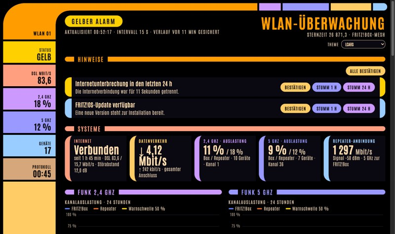

File: [`themes/lcars.css`](themes/lcars.css)

### Klingon

Uses black, blood red, and bronze with angular cut corners and blade shapes. Features military stencil headings, stardates, and Star Trek alarm words.

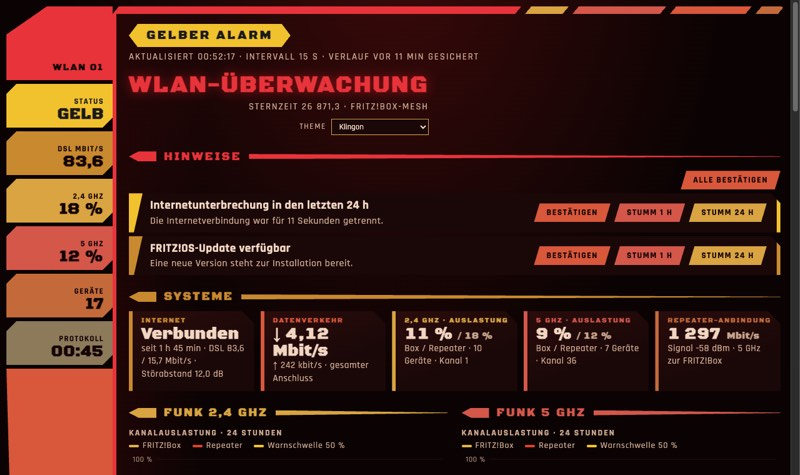

File: [`themes/klingon.css`](themes/klingon.css)

### Futuristic

Shows dark neon in cyan and magenta over a faint grid. Features translucent glass cards, glowing outlines, and gradient titles in a wide font.

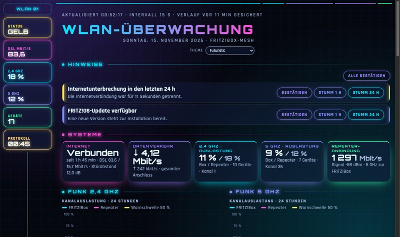

File: [`themes/futuristic.css`](themes/futuristic.css)

### Tron

Features a black grid world with cyan light lines and orange accents. Includes cut corners and a glowing grid floor extending to the horizon.

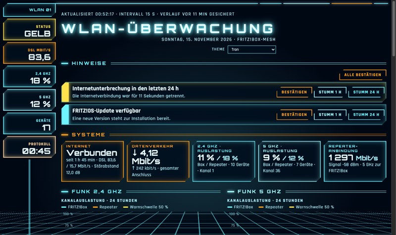

File: [`themes/tron.css`](themes/tron.css)

### Matrix

Displays a black screen with slowly falling green glyphs behind the page. Text glows green for a digital rain effect.

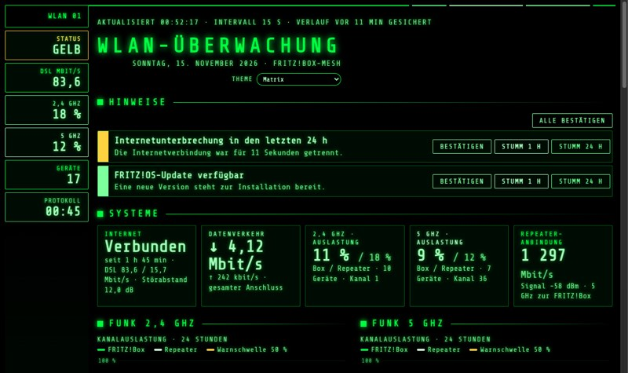

File: [`themes/matrix.css`](themes/matrix.css)

### Blade Runner

Features a rainy neon night with pink and cyan lights on dark backgrounds. Drifting rain, fog, and hologram scan lines appear on the cards.

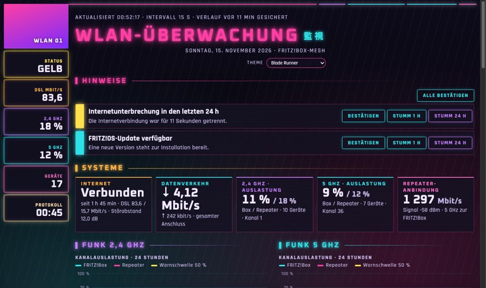

File: [`themes/bladerunner.css`](themes/bladerunner.css)

### Sci-Fi Holo

Displays floating cyan holograms with translucent cards featuring scan lines and cut corners. A projector cone of light and gentle flicker are included.

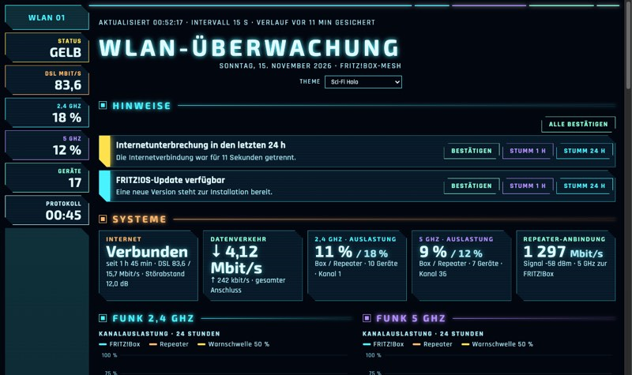

File: [`themes/holo.css`](themes/holo.css)

### Radar

Mimics a green phosphor radar screen with range rings and a rotating sweep behind the page. Cards feature targeting corners.

File: [`themes/radar.css`](themes/radar.css)

### Synthwave

Depicts an 80s retro future with purple night skies and a glowing sun. Features a magenta grid floor, chrome titles, and neon cards.

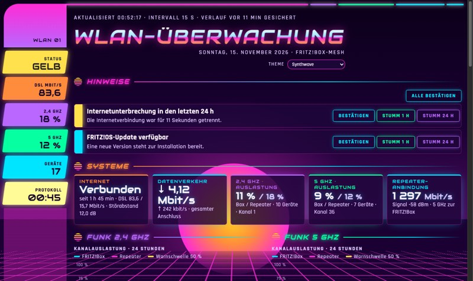

File: [`themes/synthwave.css`](themes/synthwave.css)

## Computers

### Terminal

Mimics a green phosphor text console with glow and scan lines. Displays a prompt in front of the title and includes a blinking block cursor.

File: [`themes/terminal.css`](themes/terminal.css)

### Windows 95

Mimics a Windows 95 desktop with a teal background and grey bevelled windows. Features a navy title bar, start menu side bar, and white list view.

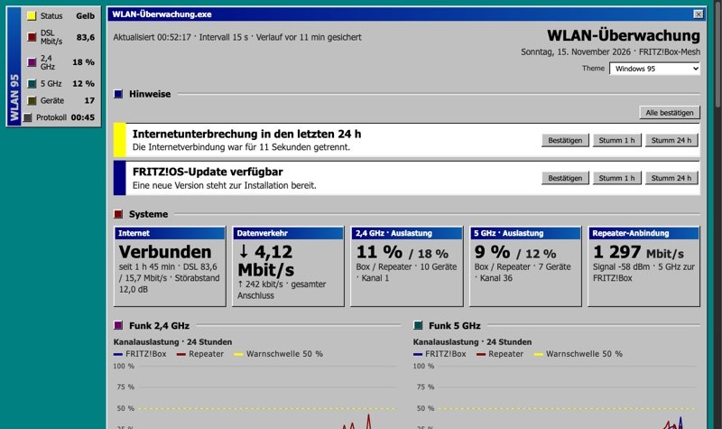

File: [`themes/win95.css`](themes/win95.css)

### MacBook

Resembles a light macOS window with three coloured dots. Features a Finder-like side bar, white rounded cards, system fonts, and standard system colours.

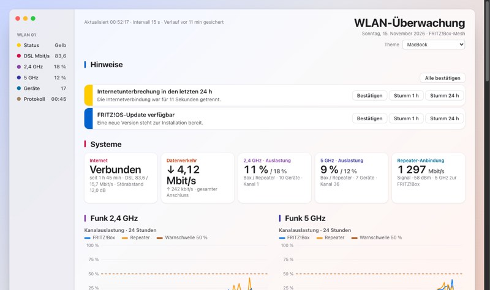

File: [`themes/macbook.css`](themes/macbook.css)

### Amiga 500

Features a blue screen with a white title bar reading '512K Chip-RAM frei'. Windows have white frames, striped drag bars, square bevelled gadgets, and a narrow pixel terminal font.

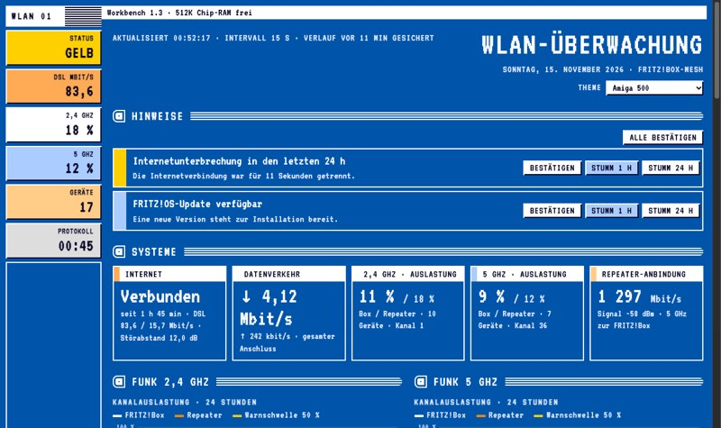

File: [`themes/amiga.css`](themes/amiga.css)

### Retro 8Bit

Features an 8-bit game look with pixel fonts and a 16-colour palette. Includes square corners, hard drop shadows, bevelled buttons, and faint CRT scan lines.

File: [`themes/retro.css`](themes/retro.css)

### Game Boy

Mimics a grey handheld with a dark bezel around a four-shade green dot-matrix screen. Includes magenta A/B buttons and a pixel font.

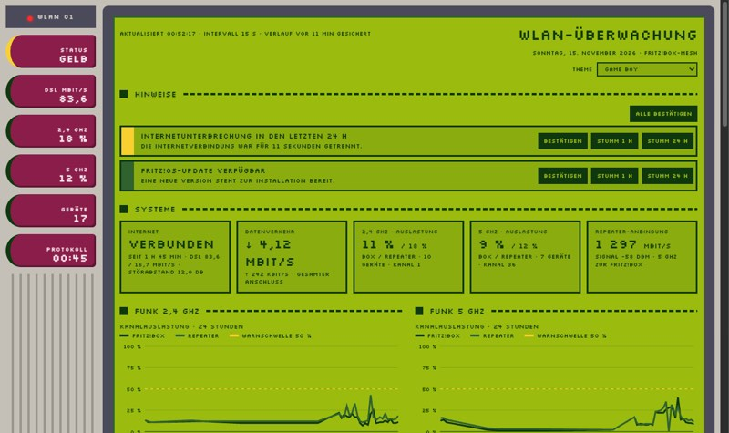

File: [`themes/gameboy.css`](themes/gameboy.css)

### Atari 2600

Displays a wood-veneer side bar and ribbed black console. Includes orange, amber, and yellow stripes with chunky block lettering for a retro gaming feel.

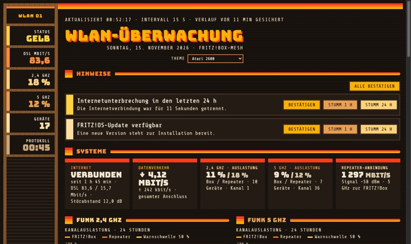

File: [`themes/atari.css`](themes/atari.css)

### Blueprint

Resembles a construction plan with white lines on blue paper. Includes a drafting grid, dimension lines under headings, and a title block.

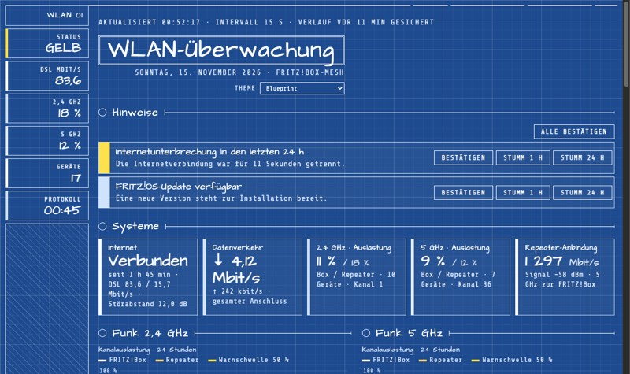

File: [`themes/blueprint.css`](themes/blueprint.css)

### Circuit Board

Resembles a green PCB with gold traces and vias. Cards look like black chips with pins, while copper pads serve as buttons.

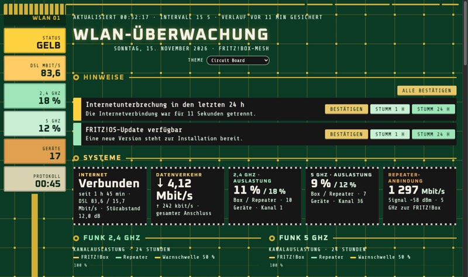

File: [`themes/circuit.css`](themes/circuit.css)

### Cockpit

Mimics an aircraft instrument panel with a grey surface and screws. Black displays show green and amber readouts alongside annunciator lights.

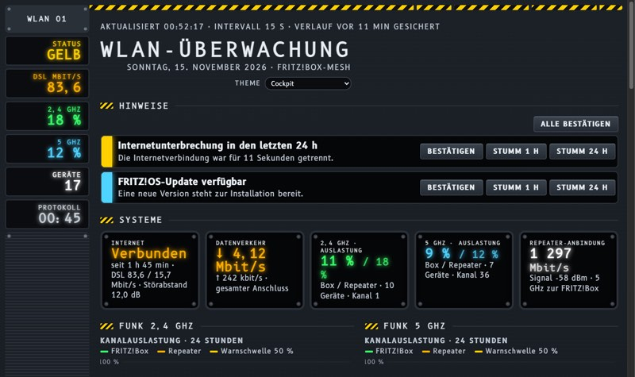

File: [`themes/cockpit.css`](themes/cockpit.css)

## Art and design

### Bauhaus

Presents primary colours on paper with geometric sans-serif fonts. Lower-case headings are accompanied by circle, square, or triangle shapes for each section.

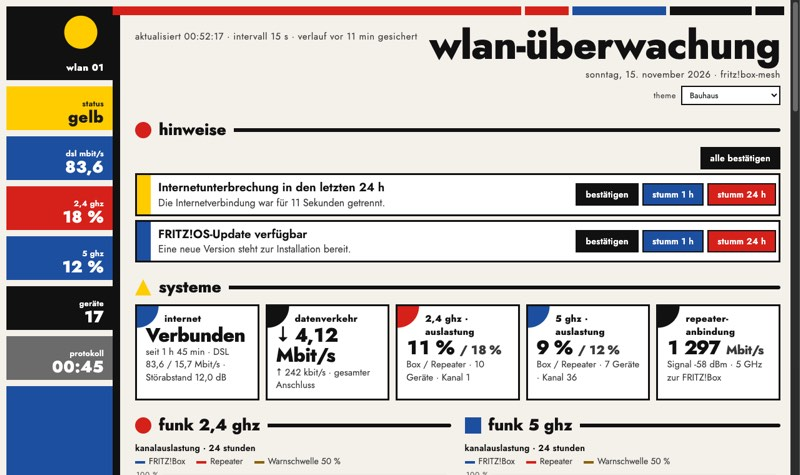

File: [`themes/bauhaus.css`](themes/bauhaus.css)

### Mondrian

Uses thick black grid lines separating red, blue, and yellow fields. Every card carries a distinct colour block on top for a geometric abstract look.

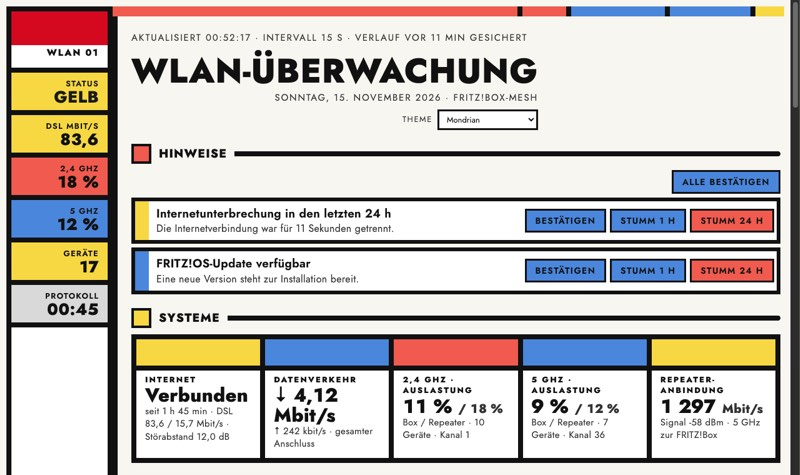

File: [`themes/mondrian.css`](themes/mondrian.css)

### Art déco

Uses black and gold with sunburst rays. Features double gold frames with stepped corners and slim geometric capitals for a classic decorative style.

File: [`themes/artdeco.css`](themes/artdeco.css)

### Pop Art

Features a comic look with halftone dots, loud colours, and thick black outlines. Includes hard offset shadows and speech-bubble alerts for a bold aesthetic.

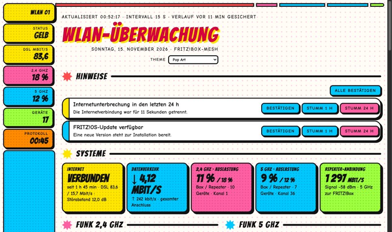

File: [`themes/popart.css`](themes/popart.css)

### Hundertwasser

Features irregularly rounded, slightly tilted cards with black outlines. The side bar has an onion dome and striped column, while the background includes spirals and colour patches with brush lettering.

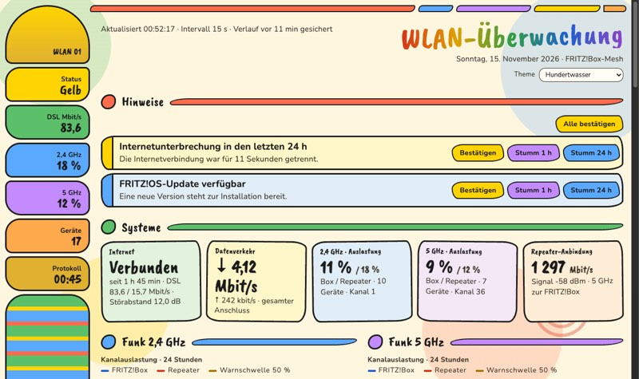

File: [`themes/hundertwasser.css`](themes/hundertwasser.css)

### Zen

Uses rice paper textures with sumi ink and red seals before every heading. Features brush-stroke lines and plenty of white space for a minimalist aesthetic.

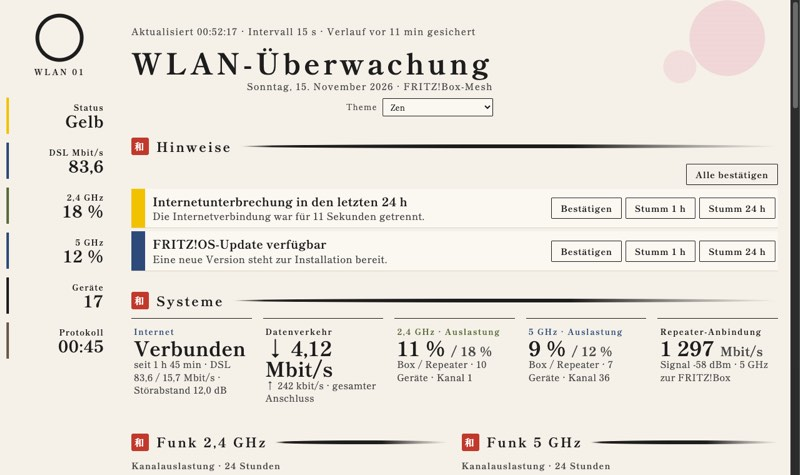

File: [`themes/zen.css`](themes/zen.css)

### Ukiyo-e

Resembles a Japanese woodblock print on washi paper. Uses Prussian blue and rust colours with wave patterns and ink outlines for a traditional aesthetic.

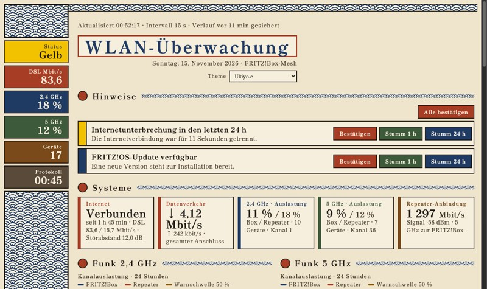

File: [`themes/ukiyoe.css`](themes/ukiyoe.css)

### Newspaper

Mimics a front page with paper tones and a blackletter masthead. Features serif text in columns separated by rules, using ink black with a red accent and no side bar.

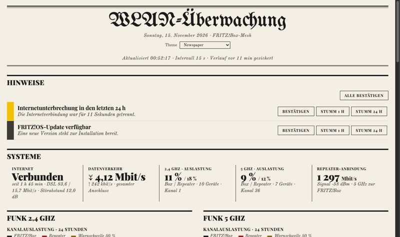

File: [`themes/newspaper.css`](themes/newspaper.css)

## Places and things

### Bahnhofsanzeige

Mimics a split-flap departure board where values sit on black tiles that flip on refresh. Headings appear as blue station signs with small 'Gleis' plates.

File: [`themes/bahnhof.css`](themes/bahnhof.css)

### Kreidetafel

Looks like a slate board with chalk dust and a wooden frame. Uses coloured chalk for hand-drawn lines and lettering throughout the dashboard.

File: [`themes/chalkboard.css`](themes/chalkboard.css)

### Notizblock

Resembles lined paper with a red margin and handwriting. Includes highlighter colours, index cards, and taped notes for a casual, analog feel.

File: [`themes/notepad.css`](themes/notepad.css)

### Kaffeehaus

Uses cream and espresso brown tones with coffee ring stains. Features menu-card typography with dotted leaders for a warm, traditional cafe atmosphere.

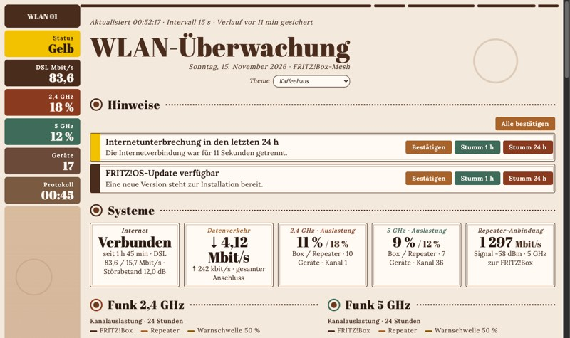

File: [`themes/coffeehouse.css`](themes/coffeehouse.css)

### Woodworker

Resembles a workshop with wood-grain backgrounds and stained board side bars. Features light plywood cards with screws, yellow measuring tapes under headings, and slab serif fonts.

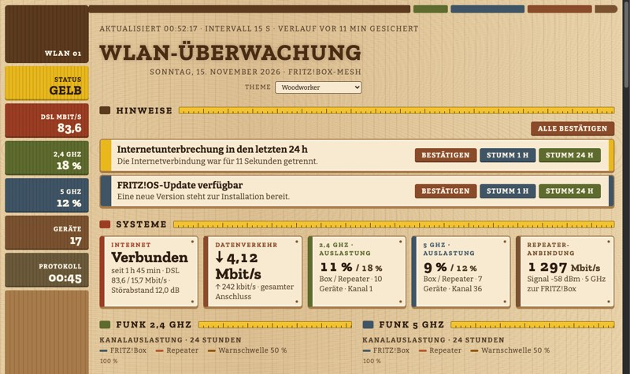

File: [`themes/woodworker.css`](themes/woodworker.css)

### Western

Resembles a wanted poster on weathered wood planks with nails. Features wood type headings, sheriff stars, and rope decorations for an old-west theme.

File: [`themes/western.css`](themes/western.css)

### Abenteuer-Pergament

Resembles a fantasy adventure map on parchment with dark edges. Features gold-framed cards, heart symbols, and a palette of forest green and gold.

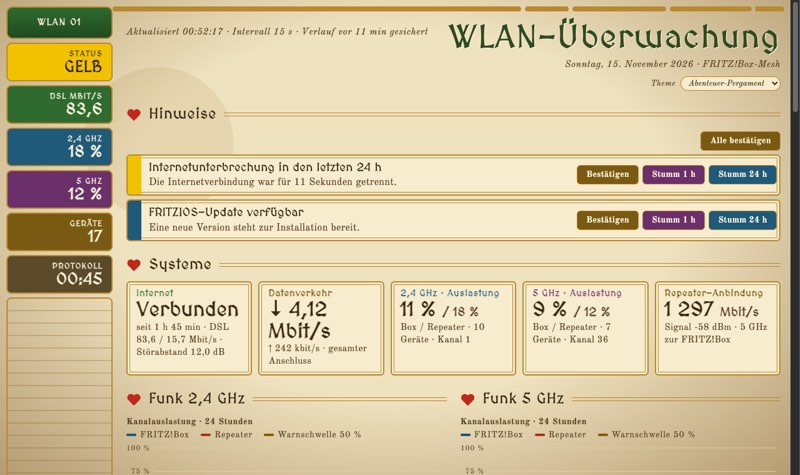

File: [`themes/parchment.css`](themes/parchment.css)

### Funkamateur

Resembles a valve radio at night with dark bakelite and brass. Features warm amber dial glow, frequency scales, and Morse-code markers.

File: [`themes/hamradio.css`](themes/hamradio.css)

## Nature and seasons

### Ozean

Depicts deep sea with a blue water gradient and rising bubbles. Features coral and sea-foam accents, rounded glass cards, and wavy lines.

File: [`themes/ocean.css`](themes/ocean.css)

### Wald

Depicts a dark forest floor with light shafts through the canopy. Uses moss and bark colours alongside leaf shapes for a natural aesthetic.

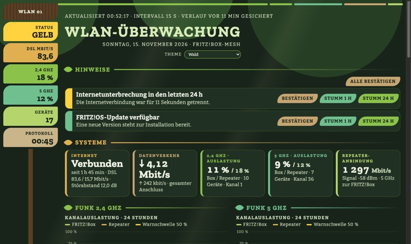

File: [`themes/forest.css`](themes/forest.css)

### Polarlicht

Shows a night sky with stars and slowly moving green-violet northern lights. Icy glass cards complete the look.

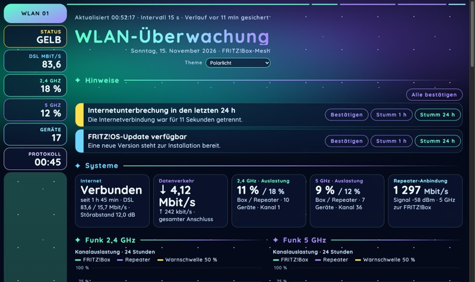

File: [`themes/aurora.css`](themes/aurora.css)

### Herbst

Uses warm paper tones with maple red, pumpkin, and mustard colours. Scattered leaves decorate the interface alongside elegant serif headings for a seasonal appearance.

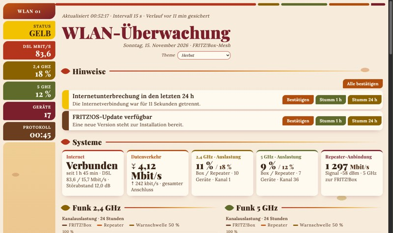

File: [`themes/autumn.css`](themes/autumn.css)

### Weihnachten

Displays fir green night skies with falling snow. Features gingerbread cards with icing, ornaments, garlands, and candy-cane buttons for a festive theme.

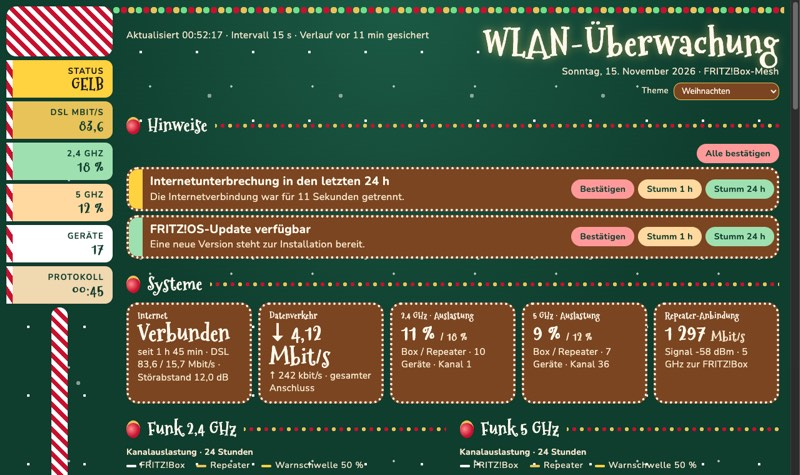

File: [`themes/christmas.css`](themes/christmas.css)

## Fun

### Pokemon

Uses red, white, blue, and yellow without characters or logos. Features game-menu frames with double edges, 3D buttons, and a ball symbol before each heading.

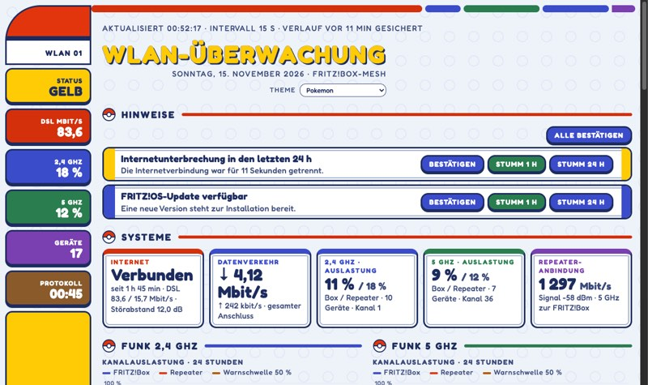

File: [`themes/pokemon.css`](themes/pokemon.css)

### Unicorn

Features pastel rainbow colours with sparkles. Cards have rainbow borders, titles use a rainbow gradient script, and a unicorn appears in front of each heading.

File: [`themes/unicorn.css`](themes/unicorn.css)

### Coca-Cola

Features red and white vintage advertising styles without logos. Includes a red side bar with white waves, script titles, and condensed poster fonts.

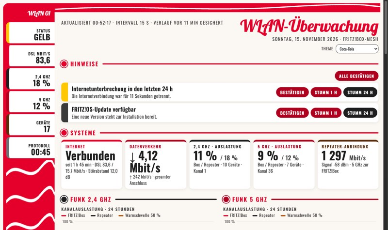

File: [`themes/cola.css`](themes/cola.css)

### Disco 70er

Uses brown, orange, and mustard colours with 70s stripes. Features mirror-ball sparkle effects, round shapes, and a chunky rounded font for a retro vibe.

File: [`themes/disco.css`](themes/disco.css)
